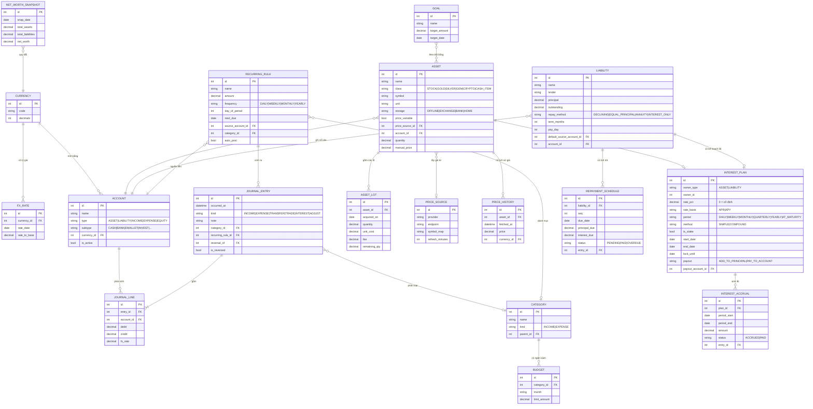

# Đặc tả ứng dụng Quản lý Tài chính Cá nhân (tên tạm: Két Số)

*Phiên bản 1.0 – Tài liệu đặc tả công nghệ, mô hình dữ liệu (ERD) và nghiệp vụ kế toán*

## 1. Tổng quan

**Mục tiêu:** một "chiếc két di động" giúp người dùng theo dõi toàn bộ tài sản, nợ, thu và chi trên một app duy nhất chạy trên Android và iOS, không cần mở két hay nhiều app ví riêng lẻ.

**Nguyên tắc thiết kế**

- **Offline-first:** toàn bộ dữ liệu nằm trong máy; chỉ cần mạng để lấy giá thị trường và tỷ giá. Mất mạng vẫn dùng đủ chức năng, giá hiển thị là giá lần cập nhật gần nhất kèm nhãn thời gian.
- **Riêng tư:** không bắt buộc tài khoản, không máy chủ lưu dữ liệu tài chính. Dữ liệu mã hoá trên thiết bị.
- **Sổ kép rút gọn:** mọi biến động tiền đều là bút toán cân bằng, bảo đảm tổng tài sản luôn khớp với thu chi.
- **Nhập nhanh:** ghi một khoản chi trong tối đa 3 chạm.

**Phạm vi:** theo dõi tài sản tiết kiệm, nợ và chi phí, thu chi hằng ngày, báo cáo. Không bao gồm giao dịch mua bán thật, kết nối trực tiếp ngân hàng hay tư vấn đầu tư.

## 2. Các yếu tố còn thiếu đã được bổ sung

Phân tích ý tưởng ban đầu cho thấy các khoảng trống sau; tất cả đã được đưa vào đặc tả.

| # | Yếu tố bổ sung | Lý do cần |
| --- | --- | --- |
| 1 | **Thu nhập** (lương, thưởng, lãi, thu khác) | Chỉ có chi thì không tính được dòng tiền và tiết kiệm ròng |
| 2 | **Chuyển khoản nội bộ** giữa các nguồn tiền | Rút ATM, gửi tiền vào tiết kiệm không phải thu hay chi |
| 3 | **Khoản nợ tổng quát** (vay ngân hàng, thẻ tín dụng, vay bạn bè) | Tính tài sản ròng = tài sản − nợ |
| 4 | **Lịch trả nợ** (dư nợ giảm dần, gốc đều, niên kim, chỉ trả lãi) | Lãi ngân hàng mỗi kỳ khác nhau tuỳ phương thức |
| 5 | **Giao dịch định kỳ** tự sinh (tiền nhà, ăn, internet) kèm nhắc nhở | Chi phí cố định không phải nhập tay |
| 6 | **Danh mục và ngân sách** theo tháng | Kiểm soát chi tiêu |
| 7 | **Mục tiêu tiết kiệm** | Tạo động lực, theo dõi tiến độ |
| 8 | **Lô tài sản (lot) và giá vốn** | Tính lãi/lỗ khi mua nhiều lần ở nhiều mức giá |
| 9 | **Phí giao dịch** | Giá vốn thực tế gồm phí |
| 10 | **Đa tiền tệ và tỷ giá** (VND, USD, ...) | Crypto và vàng thế giới tính theo USD |
| 11 | **Lịch sử giá và ảnh chụp tài sản ròng** theo ngày | Vẽ biểu đồ xu hướng, không phụ thuộc mạng |
| 12 | **Đối soát số dư** (so với tiền thực tế) | Phát hiện sai lệch, tạo bút toán điều chỉnh |
| 13 | **Bảo mật** (PIN, sinh trắc học, khoá khi chuyển nền, ẩn số dư) | Dữ liệu nhạy cảm |
| 14 | **Sao lưu, khôi phục, xuất dữ liệu** (CSV/PDF) | Mất máy không mất dữ liệu |
| 15 | **Lưu trữ tài sản số offline** (cold wallet): chỉ ghi số lượng và nơi cất, **tuyệt đối không lưu seed phrase hay khoá riêng** | An toàn |
| 16 | **Nhật ký chỉnh sửa và đảo bút toán** | Không xoá cứng, bảo đảm toàn vẹn sổ |
| 17 | **Cảnh báo giá, nhắc đến hạn kỳ trả, đáo hạn tiết kiệm, mở khoá stake** | Chủ động |

## 3. Công nghệ đề xuất

### 3.1 Lựa chọn chính

| Lớp | Công nghệ | Ghi chú |
| --- | --- | --- |
| Framework | **React Native + Expo (TypeScript)** | Một mã nguồn cho Android và iOS; tận dụng kiến thức React/Next.js |
| Điều hướng | Expo Router | 3 tab: Tổng quan, Chi tiết, Cài đặt |
| CSDL cục bộ | **SQLite** (expo-sqlite) mã hoá bằng **SQLCipher** | Quan hệ, truy vấn tổng hợp nhanh |
| ORM, migration | Drizzle ORM | Kiểu an toàn, quản lý phiên bản schema |
| Trạng thái | Zustand (UI) và TanStack Query (giá, tỷ giá) | Cache, retry, stale-while-revalidate |
| Số học tiền tệ | decimal.js hoặc lưu số nguyên nhỏ nhất | Tránh sai số số thực |
| Biểu đồ | Victory Native hoặc react-native-gifted-charts | Donut, đường, cột |
| Bảo mật | expo-local-authentication, expo-secure-store | Sinh trắc học, giữ khoá mã hoá |
| Thông báo | expo-notifications | Nhắc đến hạn, cảnh báo giá |
| Tác vụ nền | expo-background-task | Cập nhật giá định kỳ (hệ điều hành quyết định tần suất) |
| Sao lưu | Tệp mã hoá (AES-256) xuất ra bộ nhớ hoặc iCloud/Google Drive do người dùng chọn | Không cần máy chủ |

**Phương án thay thế:** Flutter (hiệu năng UI tốt, nhưng dùng Dart). Nếu cần tối đa mã dùng chung và đã quen JavaScript thì React Native hợp lý hơn.

### 3.2 Nguồn giá thị trường (cần xác minh điều kiện sử dụng, giới hạn và gói miễn phí trước khi chốt)

| Loại tài sản | Nguồn gợi ý |
| --- | --- |
| Crypto | CoinGecko API hoặc Binance public API |
| Vàng, bạc thế giới | API kim loại quý (ví dụ metals.dev, GoldAPI) |
| Vàng trong nước (SJC, PNJ, DOJI) | API tổng hợp từ bên thứ ba hoặc tự dựng proxy |
| Cổ phiếu Việt Nam | API của công ty chứng khoán (SSI, VNDirect) hoặc nguồn dữ liệu tổng hợp |
| Cổ phiếu quốc tế | Alpha Vantage, Twelve Data, Yahoo Finance |
| Tỷ giá | ExchangeRate-API, Vietcombank |

**Lưu ý kiến trúc:** nên đặt một lớp `PriceProvider` trừu tượng (interface) để thay nguồn mà không sửa nghiệp vụ. Nếu nguồn gốc có giới hạn tần suất hoặc cần khoá API, nên dựng một **proxy giá nhỏ** (ví dụ Laravel hoặc Cloudflare Workers) để cache và giấu khoá. Proxy này chỉ phục vụ giá công khai, không chứa dữ liệu người dùng.

### 3.3 Kiến trúc phân lớp

- **Presentation:** màn hình, component, hook.
- **Application (use case):** `GhiChiTieu`, `ChuyenKhoanNoiBo`, `TinhLaiKy`, `TraKyVay`, `CapNhatGia`, `ChupTaiSanRong`.
- **Domain:** thực thể, quy tắc kế toán, bộ tính lãi (thuần hàm, dễ kiểm thử).
- **Infrastructure:** repository SQLite, PriceProvider, thông báo, sao lưu.

**Tác vụ định kỳ khi mở app** (và nền nếu được): (1) sinh giao dịch định kỳ đến hạn, (2) ghi nhận lãi các kỳ đã qua, (3) cập nhật giá, (4) chụp tài sản ròng ngày, (5) lên lịch thông báo.

## 4. Đặc tả màn hình

### 4.1 Tổng quan (Dashboard)

- **Thẻ tài sản ròng:** tổng tài sản, tổng nợ, tài sản ròng; thay đổi so với hôm qua, tháng trước; nút ẩn/hiện số dư.
- **Biểu đồ donut** cơ cấu tài sản (tiền mặt, cổ phiếu, vàng bạc đá quý, tài sản số, tiết kiệm có lãi).
- **Biểu đồ đường** tài sản ròng theo 7 ngày, 30 ngày, 1 năm.
- **Dòng tiền tháng:** tổng thu, tổng chi, chênh lệch; thanh tiến độ ngân sách.
- **Sắp đến hạn (7 ngày tới):** kỳ trả lãi vay, chi phí cố định, tiết kiệm đáo hạn, stake mở khoá.
- **Nút nhập nhanh (+):** Chi, Thu, Chuyển tiền, Mua/bán tài sản.
- Chỉ báo "giá cập nhật lúc ..." và nút làm mới.

### 4.2 Chi tiết

Bốn tab con:

1. **Tài sản:** danh sách theo nhóm; mỗi dòng gồm tên, số lượng, giá hiện tại, giá trị, lãi/lỗ, lãi suất. Bấm vào xem lô, lịch sử giá, lịch sử lãi và giao dịch. Thêm tài sản: chọn nhóm → loại → số lượng/giá vốn → lãi suất, kỳ sinh lãi → nguồn tiền.
2. **Nợ và chi phí phải chi:** khoản vay (dư nợ, lãi suất, lịch trả, kỳ kế tiếp) và chi phí cố định (tần suất, số tiền, nguồn trả mặc định).
3. **Giao dịch:** lịch sử thu chi, lọc theo ngày, danh mục, nguồn tiền; tìm kiếm; sửa bằng bút toán đảo.
4. **Báo cáo:** thu chi theo danh mục, theo tháng, bảng cân đối, lãi/lỗ tài sản, xuất CSV/PDF.

### 4.3 Cài đặt

- Tiền tệ gốc, định dạng số, ngôn ngữ, múi giờ, ngày bắt đầu tháng tài chính.
- Bảo mật: PIN, sinh trắc học, tự khoá sau N phút, ẩn số dư khi mở app.
- Nguồn giá: bật/tắt, khoá API, chu kỳ cập nhật, nguồn ưu tiên cho từng loại.
- Danh mục thu chi, nguồn tiền, ngân sách.
- Thông báo: nhắc trước hạn (số ngày), cảnh báo giá.
- Sao lưu và khôi phục, xuất dữ liệu, xoá toàn bộ dữ liệu.
- Phương pháp tính giá vốn (bình quân gia quyền hoặc FIFO), quy ước đếm ngày (Thực tế/365 hoặc 30/360).

## 5. Mô hình dữ liệu (ERD)

### 5.1 Giải thích các thực thể chính

| Thực thể | Vai trò |
| --- | --- |
| ACCOUNT | Hệ thống tài khoản kế toán. Nguồn tiền (tiền mặt, ngân hàng, ví) là tài khoản loại ASSET; thu nhập và chi phí là tài khoản riêng |
| JOURNAL\_ENTRY / JOURNAL\_LINE | Sổ nhật ký: mỗi giao dịch là một bút toán gồm từ hai dòng, tổng Nợ bằng tổng Có |
| ASSET, ASSET\_LOT | Danh mục tài sản và các lô mua, dùng cho giá vốn và lãi/lỗ |
| INTEREST\_PLAN | Dùng chung cho tài sản có lãi (tiết kiệm, stake) và khoản nợ; lãi 0% nghĩa là tài sản cố định |
| INTEREST\_ACCRUAL | Từng kỳ lãi đã ghi nhận; liên kết với bút toán |
| LIABILITY, REPAYMENT\_SCHEDULE | Khoản nợ và lịch trả từng kỳ (gốc, lãi, nguồn thanh toán) |
| RECURRING\_RULE | Chi phí cố định, tự sinh bút toán hoặc nhắc người dùng xác nhận |
| PRICE\_HISTORY, NET\_WORTH\_SNAPSHOT | Dữ liệu lịch sử để vẽ biểu đồ mà không phải tính lại |

## 6. Đặc tả nghiệp vụ kế toán

### 6.1 Nguyên tắc chung

1. **Sổ kép rút gọn:** mỗi bút toán có ít nhất một dòng Nợ và một dòng Có, tổng Nợ = tổng Có (đã quy về tiền tệ gốc).
2. **Phân loại tài khoản:** Tài sản (số dư Nợ), Nợ phải trả (số dư Có), Thu nhập (Có), Chi phí (Nợ), Vốn chủ sở hữu (số dư đầu kỳ và chênh lệch đánh giá lại).
3. **Tài sản ròng = Tổng tài sản − Tổng nợ phải trả.**
4. **Bất biến sổ:** không sửa hay xoá bút toán đã ghi; sửa bằng **bút toán đảo** rồi ghi bút toán mới. Giữ vết `reversal_of`.
5. **Ghi nhận theo ngày phát sinh** (`occurred_at`), cho phép nhập lùi ngày; có tuỳ chọn khoá kỳ đã đối soát.
6. **Số học:** dùng decimal; VND làm tròn về đồng, USD 2 chữ số; làm tròn ở bước ghi nhận từng kỳ, không làm tròn trung gian.
7. **Đa tiền tệ:** mỗi dòng lưu tiền tệ gốc và tỷ giá tại thời điểm giao dịch; báo cáo quy đổi theo tỷ giá hiện hành, chênh lệch tỷ giá là lãi/lỗ chưa thực hiện.

### 6.2 Bảng định khoản mẫu

| Nghiệp vụ | Nợ | Có |
| --- | --- | --- |
| Số dư đầu kỳ (khai báo tiền hiện có) | Tiền mặt / Ngân hàng | Vốn chủ sở hữu (số dư đầu kỳ) |
| Nhận lương 20.000.000 vào ngân hàng | Ngân hàng | Thu nhập – Lương |
| Chi ăn trưa 60.000 bằng tiền mặt | Chi phí – Ăn uống | Tiền mặt |
| Rút ATM 2.000.000 | Tiền mặt | Ngân hàng |
| Mua 1 lượng vàng 80.000.000 + phí 100.000, trả bằng ngân hàng | Tài sản – Vàng (180 triệu giá vốn gồm phí) | Ngân hàng |
| Gửi tiết kiệm 50.000.000 từ ngân hàng | Tài sản – Tiết kiệm có kỳ hạn | Ngân hàng |
| Lãi tiết kiệm đến kỳ, nhập vào gốc 300.000 | Tài sản – Tiết kiệm | Thu nhập – Lãi đầu tư |
| Lãi tiết kiệm đến kỳ, trả về ngân hàng 300.000 | Ngân hàng | Thu nhập – Lãi đầu tư |
| Nhận thưởng stake 0,002 ETH (theo giá thời điểm nhận) | Tài sản – ETH (tăng số lượng) | Thu nhập – Thưởng stake |
| Vay ngân hàng 100.000.000 giải ngân vào TK | Ngân hàng | Nợ phải trả – Vay |
| Trả kỳ vay: gốc 8.000.000, lãi 1.000.000 từ ngân hàng | Nợ phải trả – Vay (gốc); Chi phí – Lãi vay | Ngân hàng |
| Bán 0,5 vàng, giá bán lớn hơn giá vốn | Tiền / Ngân hàng | Tài sản – Vàng (theo giá vốn); Thu nhập – Lãi thực hiện (chênh lệch) |
| Đối soát phát hiện thiếu tiền mặt 50.000 | Chi phí – Chênh lệch đối soát | Tiền mặt |

### 6.3 Tài sản và định giá

**Giá trị hiện tại** = số lượng × giá hiện tại (giá từ API cho tài sản biến động; giá nhập tay hoặc giá vốn cho tài sản cố định).

**Giá vốn:** bình quân gia quyền (mặc định): `giá vốn bq = tổng (số lượng × đơn giá + phí) / tổng số lượng`. Tuỳ chọn FIFO theo từng lô.

**Lãi/lỗ chưa thực hiện** = giá trị hiện tại − giá vốn còn lại. Mặc định **không** ghi bút toán mỗi lần giá đổi; chỉ hiển thị trên báo cáo. Khi bán, ghi lãi/lỗ **thực hiện**. Tuỳ chọn "ghi nhận đánh giá lại cuối tháng": Nợ/Có tài sản, đối ứng Vốn chủ sở hữu – Chênh lệch đánh giá lại.

**Giá không khả dụng:** dùng giá cuối cùng đã lưu, gắn cảnh báo "giá cũ" nếu quá ngưỡng (mặc định 24 giờ, crypto 1 giờ).

**Tài sản số offline (cold wallet):** chỉ lưu số lượng, mã coin, nơi cất. Không lưu khoá hay cụm từ khôi phục. Có nút đối chiếu số lượng.

### 6.4 Lãi suất, kỳ sinh lãi và stake

Ký hiệu: P = gốc hiện tại, r = lãi suất năm, m = số kỳ trong năm (ngày 365, tuần 52, tháng 12, quý 4, năm 1), d = số ngày thực tế trong kỳ.

| Phương pháp | Công thức lãi mỗi kỳ |
| --- | --- |
| Lãi đơn (SIMPLE), gốc cố định | `I = P0 × r × d / 365` |
| Lãi kép (COMPOUND), nhập lãi vào gốc | `I = P_đầu_kỳ × r / m`, rồi `P_cuối_kỳ = P_đầu_kỳ + I` |
| Trả lãi cuối kỳ hạn (AT\_MATURITY) | `I = P × r × tổng_ngày / 365` |
| Lãi suất 0% | `I = 0`, tài sản cố định, không tạo kế hoạch lãi |

Nếu người dùng nhập **APY** thay vì APR, quy đổi: `r_kỳ = (1 + APY)^(1/m) − 1`.

**Stake:** là tài sản có kế hoạch lãi với cờ `is_stake`.

- Thưởng trả bằng **đơn vị coin** (tăng số lượng), tính theo `số lượng × APR / m`; ghi nhận thu nhập theo giá coin tại thời điểm nhận.
- Tuỳ chọn tự động tái stake (cộng dồn vào số lượng stake) hoặc nhận về ví.
- `lock_until`: ngày mở khoá; trước ngày này, tài sản hiển thị "đang khoá" và không cho bán/chuyển. Có nhắc khi sắp mở khoá.
- Lãi suất stake thực tế biến động nên cho phép sửa APR theo thời gian; thay đổi chỉ áp dụng từ kỳ sau, các kỳ cũ giữ nguyên.

**Sinh lãi tự động:** khi mở app, hệ thống duyệt mọi kế hoạch lãi, với từng kỳ đã đến hạn mà chưa có `INTEREST_ACCRUAL` thì tạo bản ghi và bút toán tương ứng (bù các kỳ đã bỏ lỡ theo thứ tự thời gian). Mỗi kỳ chỉ sinh một lần (khoá duy nhất `plan_id + period_end`).

### 6.5 Khoản nợ và lãi ngân hàng

Khai báo: số tiền vay, lãi suất năm, thời hạn (tháng), ngày trả, phương thức, nguồn thanh toán mặc định.

| Phương thức | Gốc mỗi kỳ | Lãi mỗi kỳ |
| --- | --- | --- |
| Dư nợ giảm dần, gốc đều (EQUAL\_PRINCIPAL) | `Gốc / n` | `Dư nợ đầu kỳ × r / 12` |
| Niên kim, trả đều (ANNUITY) | `PMT − lãi kỳ` | `Dư nợ đầu kỳ × r / 12`, với `PMT = P × i / (1 − (1 + i)^(−n))`, `i = r/12` |
| Chỉ trả lãi, gốc cuối kỳ (INTEREST\_ONLY) | 0, trả toàn bộ gốc kỳ cuối | `P × r / 12` |
| Dư nợ giảm dần, trả theo thực tế (DECLINING) | Người dùng nhập | `Dư nợ × r × số ngày / 365` |

**Thanh toán một kỳ:**

1. Chọn kỳ đến hạn và **nguồn thanh toán** (mặc định theo khoản vay, có thể đổi từng lần).
2. Hệ thống sinh bút toán: Nợ "Vay" (phần gốc) và Nợ "Chi phí – Lãi vay" (phần lãi), Có nguồn tiền.
3. Trả thiếu: ghi nhận phần đã trả, kỳ ở trạng thái còn thiếu; trả dư: phần dư giảm gốc. Có hỗ trợ **trả nợ trước hạn** (tính lại lịch).
4. Quá hạn: nhắc nhở và cờ OVERDUE; phí phạt (nếu có) nhập như chi phí riêng.
5. Dư nợ còn lại ghi vào Nợ phải trả và trừ vào tài sản ròng.

Trong trường hợp tài sản (tiết kiệm) và khoản vay đều có lãi, báo cáo hiển thị **lãi ròng = lãi thu − lãi trả**.

### 6.6 Chi phí cố định và chi phát sinh

- **Chi phí cố định** (`RECURRING_RULE`): tiền nhà, ăn, internet,... với tần suất, ngày trong kỳ, số tiền, nguồn trả, danh mục. Chế độ `auto_post` tự ghi khi đến hạn; ngược lại hiện thông báo để người dùng xác nhận (có thể sửa số tiền thực tế).
- **Chi phát sinh theo ngày:** nhập thủ công gồm số tiền, danh mục, ngày, ghi chú và **nguồn tiền** (tiền hiện có, hoặc một khoản bổ sung như thu nhập mới, vay, tiền người khác đưa).
- **Khoản bổ sung nguồn tiền:** nếu nguồn chưa đủ số dư, app cảnh báo và cho phép (a) chọn nguồn khác, (b) ghi nhận thu nhập bổ sung ngay trong thao tác, hoặc (c) cho phép số dư âm tạm thời (tuỳ cài đặt; mặc định cảnh báo).
- Số dư âm tiền mặt là dấu hiệu sai lệch, được báo trong màn hình đối soát.

### 6.7 Báo cáo

| Báo cáo | Công thức, nội dung |
| --- | --- |
| Bảng cân đối | Tài sản (theo nhóm) = Nợ phải trả + Vốn chủ sở hữu (gồm tích luỹ thu − chi) |
| Thu chi tháng | Tổng thu, tổng chi theo danh mục, so với ngân sách |
| Dòng tiền | Thu − chi, chia tiền vào/ra từng nguồn |
| Tỷ lệ tiết kiệm | `(Thu − Chi) / Thu` |
| Lãi/lỗ tài sản | Chưa thực hiện và đã thực hiện theo từng tài sản |
| Quỹ dự phòng | `Tiền và tương đương tiền / chi trung bình tháng` (số tháng) |

### 6.8 Đối soát và kiểm soát

- Người dùng nhập số dư thực tế của một nguồn tiền; chênh lệch tạo **bút toán điều chỉnh** (Chi phí/Thu nhập – Chênh lệch đối soát).
- Kiểm tra toàn vẹn khi khởi động: mọi bút toán cân; tổng số dư tài khoản khớp với tài sản ròng đã tính.
- Khoá kỳ: sau khi đối soát, bút toán trong kỳ chỉ sửa bằng bút toán đảo.

## 7. Quy tắc nghiệp vụ và trường hợp biên

1. Lãi suất ≥ 0; mặc định 0%. Lãi suất 0% không sinh bản ghi lãi.
2. Kỳ sinh lãi cuối tháng gặp ngày không tồn tại (ví dụ 31) thì lấy ngày cuối tháng.
3. Nhập lùi ngày tạo tài sản/khoản vay: hệ thống tự bù các kỳ lãi đã qua; hỏi xác nhận trước khi ghi.
4. Số lượng bán không vượt số lượng nắm giữ; tài sản đang khoá stake không bán được.
5. Xoá danh mục có giao dịch: chỉ cho phép ẩn (lưu trữ), không xoá.
6. Múi giờ: lưu UTC, hiển thị theo múi giờ cài đặt; ranh giới ngày dựa trên múi giờ này.
7. Mất mạng hoặc API lỗi: giữ giá cũ, thử lại với giãn cách luỹ thừa, không chặn thao tác nhập.
8. Giá bất thường (lệch hơn 30% so với lần trước): giữ giá cũ và yêu cầu người dùng xác nhận.
9. Ngày lễ không ảnh hưởng ngày trả; không có tự động dời ngày.

## 8. Yêu cầu phi chức năng

- **Bảo mật:** SQLCipher AES-256, khoá giữ trong Keychain/Keystore, sinh trắc học mở khoá, che màn hình ở trình chuyển app, tắt chụp màn hình tuỳ chọn.
- **Hiệu năng:** mở app dưới 2 giây với 10.000 giao dịch; dashboard dùng bảng snapshot và chỉ mục theo `occurred_at`, `account_id`.
- **Độ tin cậy:** mọi ghi bút toán nằm trong transaction SQLite; sao lưu tự động hằng tuần (nếu bật).
- **Quyền riêng tư:** không phân tích hành vi, không gửi dữ liệu tài chính ra ngoài; chỉ gọi API với mã tài sản.
- **Khả dụng:** hỗ trợ chế độ tối, cỡ chữ lớn, tiếng Việt và tiếng Anh.
- **Kiểm thử:** kiểm thử đơn vị cho bộ tính lãi, giá vốn, lịch trả nợ; kiểm thử thuộc tính (tổng Nợ = tổng Có).

## 9. Lộ trình triển khai

| Giai đoạn | Nội dung | Thời gian ước tính |
| --- | --- | --- |
| MVP 1 | Nguồn tiền, thu/chi/chuyển khoản, danh mục, dashboard cơ bản, cài đặt, PIN | 3–4 tuần |
| MVP 2 | Tài sản (cố định và có lãi), kỳ sinh lãi tự động, giá từ API (crypto, vàng), lô và giá vốn | 3–4 tuần |
| MVP 3 | Khoản nợ và lịch trả, chi phí định kỳ, nhắc nhở, ngân sách | 3 tuần |
| V1.0 | Stake, đa tiền tệ, báo cáo, đối soát, sao lưu mã hoá, mục tiêu | 3–4 tuần |
| Sau V1 | Cổ phiếu, widget màn hình chính, nhập từ CSV, đồng bộ đa thiết bị mã hoá đầu cuối | tuỳ chọn |

## 10. Rủi ro và lưu ý

- **API giá:** điều khoản, giới hạn truy vấn và gói miễn phí thay đổi; cần kiểm tra trước khi phát hành và có nguồn dự phòng. Đây là rủi ro lớn nhất của dự án.
- **Tác vụ nền** trên iOS bị hệ điều hành giới hạn nên ghi nhận lãi theo kiểu "bù khi mở app" là cơ chế chính, không dựa vào nền.
- **Sao lưu:** vì không có máy chủ, người dùng mất mật khẩu sao lưu là mất dữ liệu; cần cảnh báo rõ khi bật.
- **Pháp lý:** app chỉ hỗ trợ theo dõi, không phải tư vấn tài chính hay thuế; nên có dòng khuyến cáo trong phần giới thiệu.
- **Không lưu seed phrase hay khoá riêng** trong bất kỳ trường hợp nào, kể cả ghi chú.
