# FinaTec — Báo cáo hiện trạng sản phẩm, nghiệp vụ và cơ sở dữ liệu

- **Ngày chốt báo cáo:** 2026-11-04
- **Repository:** https://github.com/launnguyen001/FinaTec
- **Baseline tích hợp trên `main`:** `fe91858b6ae71d8f5f51d7ad664db1631e06dedb` (TASK-05)
- **Nhánh TASK-06:** `task/06-liability-management` — PR #8, chưa merge tại thời điểm audit
- **Nhánh khắc phục audit:** `remediation/audit-00-06` — PR #9 Draft
- **Nhánh chứa báo cáo:** `docs/project-state-audit-2026-11-04`
- **Phạm vi:** Core Specification, Product Roadmap, task documents TASK-00…TASK-10, Drizzle schema, migration chain, source code và audit report hiện có.

> **Cách đọc trạng thái:** Báo cáo phân biệt (1) đã có code, (2) test tự động/CI, (3) nghiệm thu trên thiết bị, và (4) đã tích hợp vào `main`. Một task có thể đã hoàn thiện ở branch riêng nhưng chưa có trong `main`. Kết quả thiết bị được ghi nhận theo acceptance evidence trong repository; báo cáo này không tuyên bố đã tự chạy lại trên thiết bị.

---

## 1. Tóm tắt điều hành

### 1.1 Sản phẩm đang xây dựng

FinaTec (tên sản phẩm trong tài liệu nghiệp vụ là **Két Số**) là ứng dụng quản lý tài chính cá nhân chạy Android/iOS, theo bốn nguyên tắc:

1. **Offline-first:** nghiệp vụ tài chính cốt lõi chạy trên thiết bị, không phụ thuộc kết nối mạng.
2. **Privacy-first:** dữ liệu tài chính lưu cục bộ và được mã hóa bằng SQLite + SQLCipher; không cần tài khoản cloud hoặc máy chủ lưu dữ liệu tài chính.
3. **Accounting-based:** mọi biến động tài chính được ghi nhận qua double-entry Ledger; Ledger là nguồn sự thật duy nhất về số dư.
4. **Unified wealth view:** tổng hợp tiền, tài sản, lãi phát sinh và nghĩa vụ nợ để tiến tới bức tranh tài sản ròng.

Ứng dụng **không** phải ngân hàng số hoặc nền tảng giao dịch: không thực hiện lệnh mua/bán tài sản, không kết nối ngân hàng để tự động lấy giao dịch, không lưu private key/seed phrase, không đưa ra tư vấn đầu tư và không gửi dữ liệu tài chính cá nhân lên provider giá.

### 1.2 Mức độ hoàn thành theo roadmap

| Task | Phân hệ | Trạng thái implementation được ghi nhận | Kết quả/giới hạn chính |
|---|---|---|---|
| TASK-00 | Project Foundation | DONE | Expo Router, TypeScript, tooling, SQLCipher/Drizzle spike; Android được xác minh. iOS runtime chưa xác minh. |
| TASK-01 | Database Architecture | DONE | Ledger schema nền, migration, repository, data dictionary, constraints và SQLCipher-aware initialization. |
| TASK-02 | Accounting Engine | DONE | Double-entry validation, FX rational, idempotency, atomic posting, reversal/replacement. |
| TASK-03 | Core Finance | DONE theo task closeout; có audit finding | Account, Category, income, expense, transfer, opening balance, history, Dashboard. F-01 đã được sửa trên remediation branch; cần test composition root. |
| TASK-04 | Asset Management | COMPLETED | Asset catalog, lots, DCA, BUY/SELL, cost basis, quotes, daily valuation; Android acceptance 15/15. Metals provider deferred; iOS chưa xác minh. |
| TASK-05 | Interest Engine | COMPLETED | Nominal APR, ACT/365 Fixed, BigInt/rational, accrual, capitalization/payout, catch-up; Android acceptance 8/8. |
| TASK-06 | Liability Management | DEVICE ACCEPTED ở lượt 2 | Bốn phương pháp trả nợ, payment, APR history, FX snapshot, reversal/replacement, reconciliation. PR #8 chưa merge; automated real-SQLite regression còn thiếu. |
| TASK-07 | Recurring & Budget | NOT STARTED | Giao dịch định kỳ, lịch nhắc, ngân sách. |
| TASK-08 | Reports & Reconciliation | NOT STARTED | Báo cáo nâng cao, net-worth snapshots, đối soát. |
| TASK-09 | Security & Backup | NOT STARTED / NOT COMPLETE | PIN/biometric, ẩn số dư, encrypted backup/restore, export và hardening. |
| TASK-10 | Release Polish | NOT STARTED | Hoàn thiện release, kiểm thử nền tảng, accessibility/performance và phân phối. |

**Diễn giải:** TASK-00…TASK-06 đã có phần implementation đáng kể; không được hiểu rằng 7/11 task đã được tích hợp vào `main`. `main` hiện chốt ở TASK-05. TASK-06 và remediation đang nằm trên các branch/PR riêng.

### 1.3 Kết luận kỹ thuật hiện tại

**Chưa đủ điều kiện tuyên bố release-ready.** Remediation branch đã xử lý một số lỗi audit quan trọng:

- **F-01 (Critical):** đã inject `CategoryRepository` vào production `AccountingService` trong `createFinanceRuntime()`.
- **F-02 (High):** đã khôi phục hai trigger bất biến currency code/precision sau migration rebuild bảng `currencies`.
- **F-05:** đã sửa truy vấn history theo Account bằng correlated `EXISTS`, để lọc theo Account nhưng vẫn trả đủ tất cả Journal Lines của Entry.
- **F-06:** đã đưa key lifecycle resolver thành module dùng chung; production sử dụng resolver này và xác thực cả stored key lẫn generated key.

Còn phải hoàn tất:

- **F-03:** automated regression chạy trên SQLite thật cho early-principal repayment, FK integrity và rollback.
- **F-04:** integration test khởi tạo production finance composition root và chạy income/expense/reversal qua đúng runtime production.
- Bổ sung regression tests cho F-05, xác minh migration trigger invariants trên database mới được tạo từ toàn bộ migration chain.
- Chạy lại đầy đủ CI và device acceptance trên đúng HEAD remediation cuối cùng trước khi merge.

---

## 2. Branch và phạm vi code đang tồn tại

### 2.1 Các mốc remote

| Ref | Vai trò | Nhận định |
|---|---|---|
| `main` @ `fe91858` | Baseline tích hợp | TASK-00…TASK-05 đã được merge; chưa có TASK-06. |
| `task/06-liability-management` | Implementation TASK-06 | Có code, migration 0006–0010, UI và device acceptance; PR #8. |
| `remediation/audit-00-06` | Khắc phục audit tổng | Chứa TASK-06 cùng các sửa đổi F-01/F-02/F-05/F-06; PR #9 Draft. |
| `docs/project-state-audit-2026-11-04` | Báo cáo hiện trạng | Nhánh tài liệu được tạo từ remediation branch. |

### 2.2 Tài liệu/commit tham chiếu

- [Repository](https://github.com/launnguyen001/FinaTec)
- [TASK-06 pull request #8](https://github.com/launnguyen001/FinaTec/pull/8)
- [Audit remediation pull request #9](https://github.com/launnguyen001/FinaTec/pull/9)
- [Main baseline commit fe91858](https://github.com/launnguyen001/FinaTec/commit/fe91858b6ae71d8f5f51d7ad664db1631e06dedb)
- [Database schema](https://github.com/launnguyen001/FinaTec/blob/main/AgentDocs/database-schema.md)
- [Accounting rules](https://github.com/launnguyen001/FinaTec/blob/main/AgentDocs/accounting-rules.md)
- [Project roadmap](https://github.com/launnguyen001/FinaTec/blob/main/AgentDocs/roadmap/plan.md)

### 2.3 Quy tắc đọc kết quả

- **Implemented:** có source code/schema/migration tương ứng.
- **Unit/Integration tested:** có test tự động ở đúng tầng được nêu; test service dùng mock không thay thế test repository/SQLite.
- **CI PASS:** check chạy thành công trên đúng commit được nêu; không suy rộng sang commit mới.
- **Device accepted:** có biên bản chạy trên Development Build/SQLCipher; không đồng nghĩa iOS đã được xác minh.
- **Merged:** đã có trong `main`.
- **Deferred:** có chủ đích chưa triển khai, không phải lỗi code.

---

## 3. Kiến trúc phần mềm hiện tại

### 3.1 Stack

| Lớp | Công nghệ | Vai trò |
|---|---|---|
| Mobile | React Native 0.88.1, Expo SDK ~58.0.22 | Ứng dụng Android/iOS |
| Language | TypeScript strict | Kiểu dữ liệu và logic ứng dụng |
| Navigation | Expo Router | Route và layout |
| Database | SQLite + SQLCipher | Cơ sở dữ liệu cục bộ được mã hóa |
| ORM | Drizzle ORM ~0.45.4 | Schema, query và migration |
| Secure key storage | Expo SecureStore | Lưu khóa database |
| Background | Expo Background Task / Task Manager | Hạ tầng tác vụ nền; không bảo đảm lịch chạy chính xác |
| Testing | Jest + jest-expo + React Native Testing Library | Unit/screen/integration tests |
| Build | Expo Development Build / EAS | Native build để dùng SQLCipher |

### 3.2 Ranh giới kiến trúc

```text
User Action
    |
    v
Presentation (Expo Router / Screens / Components)
    |
    v
Application (Use Cases / Services)
    |
    v
Domain (Entities / Value Objects / Business Rules)
    |
    v
Repository Interfaces
    |
    v
Infrastructure (SQLite / Drizzle / SQLCipher / Providers)
    |
    +--------------------> Local encrypted SQLite
    |
    +--------------------> External public price / FX providers
```

Quy tắc quan trọng:

- Presentation không truy cập SQLite/Drizzle trực tiếp.
- Domain không phụ thuộc React Native, Expo hoặc persistence.
- Application điều phối use case và gọi domain rules/repository contracts.
- Infrastructure triển khai SQLite repositories, migrations, key lifecycle và external providers.
- Giá thị trường/tỷ giá chỉ là dữ liệu ngoài; provider không được nhận số dư, danh mục nắm giữ hoặc lịch sử giao dịch cá nhân.
- Không ghi payload tài chính, PIN, khóa hoặc Error object có thể chứa dữ liệu nhạy cảm vào log.

### 3.3 Luồng dữ liệu kế toán chuẩn

```text
Screen
  -> Application Use Case
    -> Domain validation / Posting Plan
      -> Ledger Repository
        -> SQLite transaction
          -> Journal Entry + Journal Lines
```

Các phân hệ Asset, Interest và Liability không được tạo sổ cái thứ hai. Mỗi nghiệp vụ có subledger riêng để lưu chi tiết, nhưng biến động tiền và số dư được xác nhận qua Journal Entry/Journal Lines.

---

## 4. Nghiệp vụ đã triển khai

### 4.1 TASK-00 — Project Foundation

**Mục tiêu:** thiết lập nền tảng Android/iOS có thể build, kiểm thử và xác minh mã hóa.

Đã có:
- Expo Router và cấu trúc `src/app`, `presentation`, `application`, `domain`, `infrastructure`, `shared`.
- TypeScript, lint, format, typecheck, Jest và CI.
- SQLite + Drizzle + SQLCipher-aware initialization.
- Preflight kiểm tra `PRAGMA cipher_version`; không cho phép fallback plaintext.
- Khóa DB được lưu trong SecureStore; thiếu key khi database đã tồn tại phải fail closed.
- Diagnostic key-loss dùng database/key giả lập riêng.

Giới hạn:
- Android Development Build là nền tảng được xác minh; iOS native runtime chưa được xác minh.
- Cần kiểm tra lifecycle của database cũ với key thiếu/không hợp lệ trên cả thiết bị mục tiêu.
- F-06 đã được chuyển sang shared production resolver trên remediation branch; phải giữ test cho resolver production, không chỉ test spike.

### 4.2 TASK-01 — Database Architecture

**Mục tiêu:** chuyển ERD nền thành schema quan hệ và repository.

Đã có 5 bảng nền:
- `currencies`
- `ledger_settings`
- `accounts`
- `journal_entries`
- `journal_lines`

Đã có:
- Versioned migration, migration journal, Drizzle schema.
- Composite FK đảm bảo Journal Line dùng đúng currency cố định của Account.
- FX snapshot rational numerator/denominator.
- Tiền lưu theo integer minor units; domain dùng BigInt.
- Trigger bảo vệ posted journal history và currency/account identity.
- Foreign key RESTRICT; không hard-delete dữ liệu đã được tham chiếu.
- Không lưu account balance trực tiếp.

### 4.3 TASK-02 — Accounting Engine

**Mục tiêu:** xây bộ máy double-entry dùng chung cho mọi phân hệ.

Nghiệp vụ:
1. Tạo Draft Journal Entry.
2. Kiểm tra tối thiểu hai Journal Lines, có cả DEBIT và CREDIT.
3. Xác minh Account tồn tại, ACTIVE và đúng currency.
4. Tính lại base amount từ FX snapshot rational; không tin base amount do UI/caller truyền vào.
5. Làm tròn HALF_UP một lần trên từng line theo minor-unit precision.
6. Tổng Debit phải bằng tổng Credit theo base currency.
7. Ghi Entry và Lines trong một SQLite transaction.
8. Retry cùng idempotency key trả kết quả đã ghi, không tạo duplicate.
9. POSTED Entry/Lines bất biến; sửa sai bằng reversal hoặc adjustment/replacement.

Các use case nền:
- Draft/post.
- Opening balance.
- Internal transfer.
- Balance lookup.
- Reversal.
- Replacement/adjustment.

Quy ước normal balance:
- ASSET, EXPENSE: DEBIT.
- LIABILITY, EQUITY, INCOME: CREDIT.

### 4.4 TASK-03 — Core Finance

**Mục tiêu:** quản lý tiền hằng ngày.

**Account**
- Tạo, xem, cập nhật metadata, archive và restore.
- Loại: ASSET, LIABILITY, EQUITY, INCOME, EXPENSE.
- ASSET subtype: CASH, BANK, EWALLET, SAVINGS, OTHER.
- Không lưu số dư trên Account; số dư được tính từ POSTED Journal Lines.
- Chỉ archive khi số dư Ledger theo native currency bằng chính xác 0.
- Account đã archive không được dùng trong posting mới; phải restore trước.

**Category**
- Category INCOME/EXPENSE riêng biệt với Account.
- Có phân cấp cha–con.
- Parent/child phải cùng kind; không tự làm cha hoặc tạo chu trình.
- Category đã dùng không được đổi kind; archive thay cho hard-delete.

**Thu nhập**
- Tiền đi vào phạm vi tài sản người dùng quản lý.
- Debit ASSET / Credit INCOME.
- Category phải thuộc kind INCOME.

**Chi phí**
- Mọi khoản tiền rời khỏi phạm vi tài sản người dùng quản lý đều là EXPENSE.
- Debit EXPENSE / Credit ASSET.
- Không tạo transaction kind riêng cho rút vốn/chi phí doanh nghiệp/mục đích rút tiền. Người dùng tự phân loại bằng Category và note.
- Category phải thuộc kind EXPENSE.

**Chuyển tiền nội bộ**
- Chỉ chuyển giữa hai ASSET Account thuộc cùng phạm vi quản lý.
- Không tạo INCOME hoặc EXPENSE.
- Không làm thay đổi tổng tài sản.

**Opening balance**
- Tạo Journal Entry đối ứng EQUITY; không ghi số dư trực tiếp lên Account.

**History**
- Dựa trên `occurred_at`, có bộ lọc thời gian, Category và Account.
- Giao dịch POSTED không được sửa/xóa trực tiếp.
- Reversal phải được tính theo ảnh hưởng ròng, không bị đếm thành giao dịch thu/chi độc lập.

**Dashboard**
- Tiền khả dụng.
- Tổng thu.
- Tổng chi.
- Dòng tiền ròng = tổng thu − tổng chi.
- Số liệu được nhóm theo native currency; không cộng VND/USD trực tiếp thành một số tổng không có đơn vị.
- Account INVESTMENT được loại khỏi available cash theo quyết định kiến trúc.

**Audit:** F-01 ban đầu do production runtime không truyền CategoryRepository vào AccountingService, khiến income/expense bị lỗi resolve Category. Remediation branch đã sửa injection. F-04 vẫn cần integration test boot chính composition root để ngăn lỗi tái diễn. F-05 đã sửa query Account filter theo correlated EXISTS; cần test truy vấn thực tế.

### 4.5 TASK-04 — Asset Management

**Mục tiêu:** theo dõi tài sản, số lượng nắm giữ, giá vốn, định giá và P&L; không thực hiện giao dịch thật.

Phân loại:
- **STABLE_VALUE:** tiền mặt, ngân hàng, tiền gửi; giá trị lấy từ Ledger Account, không tạo bản sao số dư trong Asset.
- **MARKET_VALUED:** crypto, kim loại, cổ phiếu và tài sản có giá thị trường; dùng quantity × market price.

Nghiệp vụ:
1. Quản lý Asset Type và Asset profile.
2. Ghi nhận nhiều purchase lots cho một Asset.
3. BUY/SELL liên kết Cash Account, Investment Account và Journal Entry.
4. Lưu quantity, execution price, gross amount, net cash, fee và cost basis.
5. Theo dõi remaining quantity và remaining cost basis sau partial sale.
6. DCA: hợp nhất nhiều lot thành aggregate lot; lưu component links để truy vết, không tạo giao dịch Ledger.
7. Giá API là giá tham khảo, không thay thế execution price.
8. Giá manual phải lưu source MANUAL và timestamp.
9. Giá cũ phải được đánh dấu STALE, không giả vờ là quote mới.
10. Daily valuation snapshot: mỗi Asset có một valuation record theo ngày; refresh nhiều lần trong ngày cập nhật record ngày đó, không tạo bản ghi mỗi lần refresh.
11. Unrealized P&L thay đổi theo market valuation; không tự tạo Journal Entry.
12. Realized P&L phát sinh theo nghiệp vụ bán và cost basis tương ứng.
13. Archive có guard; lịch sử lot/transaction/valuation phải truy vết được.

Provider được ghi nhận:
- CoinPaprika.
- CoinGecko Demo (cần API key nếu cấu hình).
- Frankfurter cho dữ liệu FX phù hợp.
- Metals provider chưa tích hợp; manual valuation vẫn có.

**Acceptance được ghi nhận:** Android arm64 Development Build, SQLCipher 4.17.0, 15/15 checks PASS. iOS NOT VERIFIED; OS background execution là best-effort, không bảo đảm thời điểm chạy chính xác.

**Audit F-02:** migration 0004 rebuild bảng currencies từng làm mất trigger currency immutability; remediation branch đã tạo lại hai trigger. Phải kiểm chứng trên database mới được tạo lại từ migration chain, vì database dev cũ có thể đã lưu migration journal.

### 4.6 TASK-05 — Interest Engine

**Mục tiêu:** tính lãi cho tài sản/tiền gửi và ghi nhận lãi qua Ledger.

MVP đã duyệt:
- Nominal APR, lưu integer ppm.
- ACT/365 Fixed.
- Daily accrual, kỳ lịch start-inclusive/end-exclusive.
- Posting monthly hoặc at maturity.
- Simple interest mặc định; compound chỉ sau capitalization được cho phép.
- HALF_UP tại thời điểm posting; giữ fractional carry trước posting.
- Catch-up các kỳ bỏ lỡ theo plan và idempotency key.
- Accrued chưa POSTED không làm tăng Ledger balance.
- Principal lấy từ Ledger Account; không lưu principal/balance trùng lặp trong Asset domain.

Hạch toán:
- Capitalization: Debit principal ASSET / Credit interest INCOME.
- Payout: Debit receiving ASSET / Credit interest INCOME.
- Mọi Journal Entry được ghi cùng trạng thái accrual trong transaction nguyên tử.

**Acceptance được ghi nhận:** CI PASS; Android Development Build SQLCipher 8/8 PASS.

Giới hạn chủ động:
- APY conversion chưa hỗ trợ.
- Liability interest posting được chuyển sang TASK-06.
- Staking reward quantity, early-withdrawal penalty, variable-principal schedule và OS background execution chính xác chưa thuộc MVP.
- FX interest posting không hỗ trợ trong baseline đã duyệt.

### 4.7 TASK-06 — Liability Management

**Mục tiêu:** quản lý khoản vay/nghĩa vụ nợ do người dùng tự khai báo; không đăng ký vay hoặc tự động thanh toán qua ngân hàng.

Phương pháp trả nợ:
- DECLINING — dư nợ giảm dần, nhập gốc từng kỳ; lãi theo ACT/365 Fixed.
- EQUAL_PRINCIPAL — gốc đều.
- ANNUITY — khoản trả định kỳ theo PMT.
- INTEREST_ONLY — chỉ trả lãi trong kỳ, xử lý gốc theo kỳ hạn.

Quy tắc tính:
- APR integer ppm.
- BigInt/rational; HALF_UP ở ranh giới posting.
- Kỳ cuối điều chỉnh để tổng gốc trả đúng bằng gốc ban đầu.
- Ngày đến hạn được neo cuối tháng khi phù hợp; lưu snapshot APR/điều khoản theo kỳ.
- APR mới chỉ áp dụng kỳ chưa đến hạn; không sửa lịch sử kỳ đã thanh toán/quá hạn.

Thanh toán:
- Thanh toán thiếu/đủ/thừa.
- Phân bổ lãi trước, sau đó gốc theo policy.
- Phí được ghi riêng thành EXPENSE.
- Idempotency cho payment.
- Trả gốc trước hạn có hai chính sách:
  1. KEEP_MATURITY_REDUCE_INSTALLMENT: giữ kỳ hạn, giảm số tiền trả các kỳ còn lại.
  2. KEEP_INSTALLMENT_SHORTEN_TERM: giữ số tiền trả định kỳ, rút ngắn thời hạn.
- Không tự tạo phí phạt; phí (nếu có) do người dùng nhập.
- Reversal tạo Journal Entry mới, liên kết payment gốc; không sửa/xóa payment hoặc posted journal.
- Payment replacement có liên kết replacesPaymentId.
- Reversal theo thứ tự ngược thời gian để không phá vỡ phân bổ các payment sau.
- Archive chỉ khi dư nợ gốc bằng 0, không còn nghĩa vụ chưa thanh toán và reconciliation không có chênh lệch.

Hạch toán:
- Nhận khoản vay: Debit ASSET / Credit LIABILITY.
- Trả gốc: Debit LIABILITY.
- Trả lãi: Debit EXPENSE.
- Nguồn thanh toán: Credit ASSET.
- Một payment tạo một Journal Entry cân bằng cho gốc, lãi, phí và nguồn tiền.
- Dư nợ LIABILITY phải đối soát với Ledger.

**Nghiệm thu thiết bị:** lượt 1 gặp FK constraint ở early-principal repayment. Lỗi được sửa bằng cách insert installment mới trước audit rows tham chiếu installment đó. Lượt 2 được ghi nhận PASS trên Huawei LYA-L29 / Android 10, SQLCipher 4.17.0; các check origination, partial allocation, idempotency, reversal, replacement, APR reset, early principal, payoff, archive, fee và reconciliation đều PASS, chênh lệch bằng 0.

**Khoảng trống còn lại:** test service hiện có chưa thay thế automated test chạy repository trên SQLite thật cho thứ tự ghi/FK/rollback. Đây là F-03. PR #8 có CI PASS được ghi nhận trên một HEAD trước đó; không tự động suy ra CI đã pass trên mọi commit sửa cuối cùng.

---

## 5. ERD hiện tại

ERD dưới đây mô tả schema đã có trong branch TASK-06/remediation (24 bảng). `main` hiện chưa tích hợp phần liability của TASK-06. Một số quan hệ nghiệp vụ được quản lý ở service layer; chú thích rõ nơi không có FK trực tiếp.

```mermaid
erDiagram
  CURRENCIES ||--o{ ACCOUNTS : currency
  CURRENCIES ||--o| LEDGER_SETTINGS : base_currency
  CURRENCIES ||--o{ JOURNAL_ENTRIES : base_currency
  CURRENCIES ||--o{ JOURNAL_LINES : native_currency
  ACCOUNTS ||--o{ JOURNAL_LINES : posts
  JOURNAL_ENTRIES ||--|{ JOURNAL_LINES : contains
  CATEGORIES o|--o{ JOURNAL_ENTRIES : classifies
  JOURNAL_ENTRIES o|--o| JOURNAL_ENTRIES : reverses
  JOURNAL_ENTRIES o|--o| JOURNAL_ENTRIES : replaces

  CURRENCIES ||--o{ ASSET_TYPES : quote_currency
  CURRENCIES ||--o{ ASSETS : quote_currency
  CURRENCIES ||--o{ ASSET_LOTS : cost_currency
  CURRENCIES ||--o{ ASSET_TRANSACTIONS : transaction_currency
  CURRENCIES ||--o{ ASSET_PRICE_QUOTES : quote_currency
  CURRENCIES ||--o{ ASSET_DAILY_VALUATIONS : valuation_currency
  ASSET_TYPES ||--o{ ASSETS : defines
  ASSETS ||--o{ ASSET_LOTS : owns
  ASSET_LOTS ||--o{ ASSET_DCA_COMPONENTS : aggregate_lot
  ASSET_LOTS ||--o| ASSET_DCA_COMPONENTS : component_lot
  ASSET_LOTS ||--o{ ASSET_TRANSACTIONS : transaction_lot
  ASSETS ||--o{ ASSET_TRANSACTIONS : traded_asset
  ASSETS ||--o{ ASSET_PRICE_QUOTES : has_quotes
  ASSETS ||--o{ ASSET_DAILY_VALUATIONS : snapshots
  ACCOUNTS ||--o{ ASSET_TRANSACTIONS : cash_account
  ACCOUNTS ||--o{ ASSET_TRANSACTIONS : investment_account
  JOURNAL_ENTRIES ||--o| ASSET_TRANSACTIONS : ledger_posting
  CATEGORIES o|--o{ ASSET_TRANSACTIONS : fee_category

  ACCOUNTS ||--o{ INTEREST_PLANS : principal_account
  ACCOUNTS ||--o{ INTEREST_PLANS : interest_income_account
  ACCOUNTS o|--o{ INTEREST_PLANS : payout_account
  INTEREST_PLANS ||--o{ INTEREST_ACCRUALS : accrues
  JOURNAL_ENTRIES o|--o| INTEREST_ACCRUALS : posts_accrual

  CURRENCIES ||--o{ LIABILITIES : debt_currency
  ACCOUNTS ||--o| LIABILITIES : liability_account
  ACCOUNTS ||--o{ LIABILITIES : interest_expense_account
  LIABILITIES ||--o{ LIABILITY_INSTALLMENTS : schedule
  LIABILITIES ||--o{ LIABILITY_PAYMENTS : payments
  ACCOUNTS ||--o{ LIABILITY_PAYMENTS : source_account
  JOURNAL_ENTRIES ||--o| LIABILITY_PAYMENTS : payment_posting
  LIABILITY_PAYMENTS ||--o{ LIABILITY_PAYMENT_ALLOCATIONS : allocates
  LIABILITY_INSTALLMENTS ||--o{ LIABILITY_PAYMENT_ALLOCATIONS : allocated_to
  LIABILITY_PAYMENTS ||--o{ LIABILITY_PAYMENT_SCHEDULE_CHANGES : changes_schedule
  LIABILITY_INSTALLMENTS ||--o{ LIABILITY_PAYMENT_SCHEDULE_CHANGES : changed_installment
  LIABILITIES ||--o{ LIABILITY_RATE_CHANGES : rate_history
  LIABILITY_PAYMENTS ||--o| LIABILITY_PAYMENT_REVERSALS : reversed_by
  JOURNAL_ENTRIES ||--o| LIABILITY_PAYMENT_REVERSALS : reversal_posting
```



### 5.1 Ghi chú ERD

- `asset_settings` và `asset_refresh_states` là bảng cấu hình/trạng thái provider, không có quan hệ FK nghiệp vụ với Asset.
- `asset_dca_components` là bảng nối self-reference giữa aggregate lot và component lot; mỗi component lot chỉ được gắn một aggregate nhờ UNIQUE.
- `asset_transactions.price_quote_id` hiện là text reference nhưng schema không khai báo FK trực tiếp tới `asset_price_quotes.id`; cần cân nhắc bổ sung FK trong migration tương lai nếu muốn DB bảo vệ quan hệ này.
- `interest_plans` tham chiếu Ledger Account cho principal, interest income và payout; không giữ principal balance riêng.
- `liability_payments.schedule_id` có thể null vì payment có thể không gắn duy nhất với một kỳ; chi tiết phân bổ nhiều kỳ nằm ở `liability_payment_allocations`.
- `liability_payment_reversals` nối payment gốc với Journal Entry reversal; payment gốc không bị xóa.
- `liability_payment_schedule_changes` là audit trail cho các installment bị hủy/tạo khi đổi APR hoặc trả gốc trước hạn.

---

## 6. Data Dictionary — danh sách bảng và ý nghĩa từng field

**Quy ước chung**
- `PK`: khóa chính; `FK`: khóa ngoại; `UK`: duy nhất.
- `TEXT`: chuỗi; `INTEGER`: số nguyên; `BOOLEAN`: SQLite integer 0/1.
- Timestamp/ngày được lưu dạng TEXT chuẩn hóa (ISO 8601 hoặc ngày lịch theo contract của từng cột).
- Các cột tiền `*_minor` là integer theo minor unit của currency (ví dụ VND 0 chữ số thập phân, USD 2 chữ số); không phải số tiền major-unit hiển thị.
- Các giá trị quantity/price/rational được lưu TEXT để tránh lỗi floating-point; domain parse sang BigInt/decimal representation phù hợp.
- Nullable được ghi rõ; nếu không ghi nullable thì field bắt buộc theo schema.

### 6.1. Bảng nền tảng và Ledger

#### 1. `currencies` — Danh mục tiền tệ

| Field | Kiểu | Ràng buộc | Ý nghĩa |
|---|---|---|---|
| `code` | TEXT | PK | Mã tiền tệ viết hoa, ví dụ VND, USD, USDT; là định danh currency. |
| `name` | TEXT | NOT NULL | Tên đầy đủ của tiền tệ. |
| `minor_unit` | INTEGER | 0–6 | Số chữ số thập phân nhỏ nhất dùng khi lưu/hiển thị tiền; VND=0, USD=2, USDT=6. |
| `is_active` | BOOLEAN | NOT NULL | Tiền tệ có được phép dùng cho giao dịch mới hay không. |
| `created_at` | TEXT | NOT NULL | Thời điểm tạo danh mục tiền tệ. |

#### 2. `ledger_settings` — Cấu hình sổ cái

| Field | Kiểu | Ràng buộc | Ý nghĩa |
|---|---|---|---|
| `id` | INTEGER | PK, CHECK = 1 | Khóa singleton; bảo đảm chỉ có một bản ghi cấu hình Ledger. |
| `base_currency_code` | TEXT | FK → currencies.code | Tiền tệ cơ sở dùng để quy đổi và cân bằng bút toán. |
| `created_at` | TEXT | NOT NULL | Thời điểm khởi tạo cấu hình. |
| `updated_at` | TEXT | NOT NULL | Thời điểm cập nhật cấu hình gần nhất. |

#### 3. `accounts` — Tài khoản kế toán/nguồn tiền

| Field | Kiểu | Ràng buộc | Ý nghĩa |
|---|---|---|---|
| `id` | TEXT | PK | Định danh Account. |
| `name` | TEXT | NOT NULL | Tên tài khoản do hệ thống/người dùng đặt, ví dụ Tiền mặt, Ngân hàng, Khoản vay. |
| `type` | TEXT | NOT NULL | Nhóm kế toán: ASSET, LIABILITY, EQUITY, INCOME hoặc EXPENSE; quyết định normal balance. |
| `currency_code` | TEXT | FK → currencies.code | Đồng tiền cố định của Account; không đổi sau khi tạo. |
| `is_system` | BOOLEAN | NOT NULL | Đánh dấu Account hệ thống; một số account hệ thống không được hard-delete. |
| `is_archived` | BOOLEAN | NOT NULL | Trạng thái lưu trữ; account archive vẫn giữ lịch sử nhưng không nhận posting mới. |
| `subtype` | TEXT | NULLABLE | Phân loại nguồn tiền ASSET: CASH, BANK, EWALLET, SAVINGS, OTHER; loại khác phải null. |
| `is_investment` | BOOLEAN | NOT NULL, DEFAULT false | Đánh dấu ASSET dùng cho đầu tư/tiền gửi; được loại khỏi tiền khả dụng trên Dashboard. |
| `created_at` | TEXT | NOT NULL | Thời điểm tạo Account. |
| `updated_at` | TEXT | NOT NULL | Thời điểm cập nhật metadata gần nhất. |

**Lưu ý:** không có `balance` column. Số dư luôn được suy ra từ Journal Lines của Entry POSTED.

#### 4. `categories` — Danh mục phân loại thu/chi

| Field | Kiểu | Ràng buộc | Ý nghĩa |
|---|---|---|---|
| `id` | TEXT | PK | Định danh Category. |
| `name` | TEXT | NOT NULL | Tên nhóm thu hoặc chi. |
| `kind` | TEXT | INCOME / EXPENSE | Loại Category; phải tương thích transaction kind của Journal Entry. |
| `parent_id` | TEXT | FK self → categories.id, NULLABLE | Category cha để tạo cây phân cấp. |
| `is_archived` | BOOLEAN | NOT NULL | Ngừng dùng Category cho giao dịch mới nhưng giữ lịch sử. |
| `created_at` | TEXT | NOT NULL | Thời điểm tạo Category. |
| `updated_at` | TEXT | NOT NULL | Thời điểm cập nhật Category. |

#### 5. `journal_entries` — Chứng từ/bút toán tổng

| Field | Kiểu | Ràng buộc | Ý nghĩa |
|---|---|---|---|
| `id` | TEXT | PK | Định danh bút toán. |
| `occurred_at` | TEXT | NOT NULL | Thời điểm nghiệp vụ thực sự xảy ra; dùng cho history và báo cáo thu/chi. |
| `description` | TEXT | NULLABLE | Mô tả tổng quát giao dịch/bút toán. |
| `status` | TEXT | DRAFT / POSTED | Trạng thái bút toán; chỉ POSTED mới ảnh hưởng số dư. |
| `base_currency_code` | TEXT | FK → currencies.code | Currency cơ sở được snapshot tại thời điểm tạo bút toán. |
| `idempotency_key` | TEXT | UK có điều kiện, NULLABLE | Khóa chống ghi trùng khi command được retry. |
| `transaction_kind` | TEXT | NOT NULL | Loại nghiệp vụ: INCOME, EXPENSE, TRANSFER, OPENING_BALANCE, ADJUSTMENT, REVERSAL hoặc LEGACY. |
| `category_id` | TEXT | FK → categories.id, NULLABLE | Category phân loại thu/chi; transfer/opening balance không dùng Category. |
| `reversal_of_id` | TEXT | FK self, UNIQUE có điều kiện, NULLABLE | Entry gốc bị đảo; mỗi Entry gốc tối đa một reversal. |
| `replacement_of_id` | TEXT | FK self, UNIQUE có điều kiện, NULLABLE | Entry gốc được thay thế bởi bút toán mới; không đồng thời là reversal. |
| `created_at` | TEXT | NOT NULL | Thời điểm hệ thống tạo chứng từ. |
| `posted_at` | TEXT | NULLABLE | Thời điểm ghi sổ; null với DRAFT, bắt buộc với POSTED. |

#### 6. `journal_lines` — Các dòng định khoản Nợ/Có

| Field | Kiểu | Ràng buộc | Ý nghĩa |
|---|---|---|---|
| `id` | TEXT | PK | Định danh dòng bút toán. |
| `entry_id` | TEXT | FK → journal_entries.id | Bút toán tổng chứa dòng này. |
| `line_number` | INTEGER | NOT NULL, UNIQUE theo entry | Thứ tự dòng trong một Journal Entry. |
| `account_id` | TEXT | FK ghép với currency_code → accounts | Account chịu tác động của dòng định khoản. |
| `currency_code` | TEXT | FK ghép với account_id | Currency native của số tiền trên dòng; phải đúng currency của Account. |
| `side` | TEXT | DEBIT / CREDIT | Chiều ghi Nợ hoặc Có. |
| `amount_minor` | INTEGER | Số nguyên dương | Số tiền theo native currency ở minor unit. |
| `fx_rate_numerator` | TEXT | Số nguyên dương dạng chuỗi | Tử số tỷ giá rational snapshot; tránh floating-point. |
| `fx_rate_denominator` | TEXT | Số nguyên dương dạng chuỗi | Mẫu số tỷ giá rational snapshot. |
| `base_amount_minor` | INTEGER | Số nguyên không âm | Giá trị đã quy đổi sang base currency, HALF_UP theo precision. |
| `memo` | TEXT | NULLABLE | Ghi chú riêng cho dòng định khoản. |
| `created_at` | TEXT | NOT NULL | Thời điểm tạo dòng. |

### 6.2. Asset Management

#### 7. `asset_settings` — Cấu hình định giá và refresh

| Field | Kiểu | Ràng buộc | Ý nghĩa |
|---|---|---|---|
| `id` | INTEGER | PK, singleton id=1 | Bản ghi cấu hình duy nhất cho Asset module. |
| `timezone_mode` | TEXT | DEVICE / CUSTOM | Chọn timezone theo thiết bị hay timezone do người dùng cấu hình. |
| `timezone_id` | TEXT | NOT NULL | Mã timezone IANA dùng để chốt ngày valuation. |
| `crypto_refresh_minutes` | INTEGER | 15–1440 | Chu kỳ refresh crypto theo phút. |
| `metal_refresh_minutes` | INTEGER | 15–1440 | Chu kỳ refresh kim loại theo phút. |
| `fiat_refresh_minutes` | INTEGER | 15–10080 | Chu kỳ refresh tỷ giá/fiat theo phút. |
| `primary_crypto_provider` | TEXT | NOT NULL | Provider crypto ưu tiên. |
| `fallback_crypto_provider` | TEXT | NOT NULL | Provider dự phòng khi provider chính lỗi/không có quote. |
| `updated_at` | TEXT | NOT NULL | Thời điểm cập nhật cấu hình. |

#### 8. `asset_refresh_states` — Trạng thái refresh provider

| Field | Kiểu | Ràng buộc | Ý nghĩa |
|---|---|---|---|
| `provider_key` | TEXT | PK | Khóa nhận diện provider hoặc nhóm refresh. |
| `last_attempt_at` | TEXT | NULLABLE | Lần gần nhất hệ thống thử gọi provider. |
| `last_success_at` | TEXT | NULLABLE | Lần gần nhất lấy dữ liệu thành công. |
| `failure_count` | INTEGER | NOT NULL, DEFAULT 0 | Số lần lỗi liên tiếp/được bộ điều phối ghi nhận. |
| `next_attempt_at` | TEXT | NULLABLE | Thời điểm sớm nhất được phép thử lại theo backoff. |
| `last_error` | TEXT | NULLABLE | Mã/thông tin lỗi kỹ thuật gần nhất; không được chứa secret hoặc dữ liệu tài chính cá nhân. |

#### 9. `asset_types` — Loại tài sản

| Field | Kiểu | Ràng buộc | Ý nghĩa |
|---|---|---|---|
| `id` | TEXT | PK | Định danh loại tài sản. |
| `name` | TEXT | NOT NULL | Tên loại tài sản, ví dụ Cryptocurrency, Gold. |
| `asset_class` | TEXT | CRYPTO / METAL / STOCK / OTHER | Nhóm phân loại tài sản. |
| `valuation_model` | TEXT | STABLE_VALUE / MARKET_VALUED | Cơ chế xác định giá trị: giá trị ổn định hay giá thị trường. |
| `unit_code` | TEXT | NOT NULL | Đơn vị đo quantity, ví dụ coin, gram, ounce, share. |
| `quantity_precision` | INTEGER | 0–12 | Số chữ số thập phân tối đa của số lượng. |
| `price_precision` | INTEGER | 0–12 | Độ chính xác của đơn giá. |
| `quote_currency` | TEXT | FK → currencies.code | Đồng tiền dùng để biểu diễn quote/valuation. |
| `is_archived` | BOOLEAN | NOT NULL | Ngừng chọn loại tài sản cho bản ghi mới. |
| `created_at` | TEXT | NOT NULL | Thời điểm tạo loại tài sản. |
| `updated_at` | TEXT | NOT NULL | Thời điểm cập nhật. |

#### 10. `assets` — Hồ sơ tài sản cụ thể

| Field | Kiểu | Ràng buộc | Ý nghĩa |
|---|---|---|---|
| `id` | TEXT | PK | Định danh Asset. |
| `asset_type_id` | TEXT | FK → asset_types.id | Loại tài sản mà hồ sơ này thuộc về. |
| `name` | TEXT | NOT NULL | Tên hiển thị, ví dụ Bitcoin, Vàng SJC. |
| `symbol` | TEXT | NOT NULL | Mã nhận diện do hệ thống/người dùng sử dụng. |
| `provider_symbol` | TEXT | NULLABLE | Mã ánh xạ sang provider giá bên ngoài. |
| `quote_currency` | TEXT | FK → currencies.code | Đồng tiền của giá tham chiếu cho Asset này. |
| `is_archived` | BOOLEAN | NOT NULL | Trạng thái archive hồ sơ tài sản. |
| `created_at` | TEXT | NOT NULL | Thời điểm tạo hồ sơ. |
| `updated_at` | TEXT | NOT NULL | Thời điểm cập nhật hồ sơ. |

#### 11. `asset_lots` — Lô nắm giữ/giá vốn

| Field | Kiểu | Ràng buộc | Ý nghĩa |
|---|---|---|---|
| `id` | TEXT | PK | Định danh lot/lần mua hoặc lot tổng hợp DCA. |
| `asset_id` | TEXT | FK → assets.id | Asset được nắm giữ trong lot. |
| `currency_code` | TEXT | FK → currencies.code | Currency của giá vốn. |
| `quantity` | TEXT | NOT NULL | Số lượng gốc của lot, lưu chuỗi decimal chính xác. |
| `remaining_quantity` | TEXT | NOT NULL | Số lượng còn lại sau các lần bán/điều chỉnh hợp lệ. |
| `cost_basis_minor` | INTEGER | NOT NULL | Tổng giá vốn ban đầu theo minor unit. |
| `remaining_cost_basis_minor` | INTEGER | NOT NULL | Giá vốn còn lại tương ứng với remaining quantity. |
| `acquired_at` | TEXT | NOT NULL | Thời điểm sở hữu/mua lot. |
| `status` | TEXT | ACTIVE / MERGED / CLOSED | ACTIVE đang tính vào holdings; MERGED đã nhập vào lot khác; CLOSED đã hết số lượng. |
| `merged_into_id` | TEXT | FK self, NULLABLE | Lot tổng hợp nhận lot này khi DCA merge. |
| `created_at` | TEXT | NOT NULL | Thời điểm tạo lot. |

#### 12. `asset_dca_components` — Liên kết thành phần DCA

| Field | Kiểu | Ràng buộc | Ý nghĩa |
|---|---|---|---|
| `aggregate_lot_id` | TEXT | PK ghép, FK → asset_lots.id | Lot tổng hợp sau khi DCA merge. |
| `component_lot_id` | TEXT | PK ghép, UNIQUE, FK → asset_lots.id | Lot thành phần được nhập vào aggregate; một component chỉ thuộc tối đa một aggregate. |
| `created_at` | TEXT | NOT NULL | Thời điểm tạo liên kết DCA. |

#### 13. `asset_transactions` — Giao dịch mua/bán tài sản được ghi nhận

| Field | Kiểu | Ràng buộc | Ý nghĩa |
|---|---|---|---|
| `id` | TEXT | PK | Định danh giao dịch Asset. |
| `asset_id` | TEXT | FK → assets.id | Tài sản được mua/bán. |
| `transaction_kind` | TEXT | BUY / SELL | Hành động mua hoặc bán được người dùng ghi nhận. |
| `lot_id` | TEXT | FK → asset_lots.id | Lot chịu tác động của giao dịch. |
| `quantity` | TEXT | NOT NULL | Số lượng mua/bán, decimal chính xác. |
| `execution_price` | TEXT | NOT NULL | Đơn giá giao dịch do người dùng xác nhận; không phải market quote. |
| `currency_code` | TEXT | FK → currencies.code | Currency của giao dịch/đơn giá. |
| `gross_amount_minor` | INTEGER | NOT NULL | Tổng giá trị trước phí. |
| `net_cash_amount_minor` | INTEGER | NOT NULL | Dòng tiền ròng thực tế đi/đến Cash Account. |
| `cost_basis_minor` | INTEGER | NOT NULL | Phần giá vốn được ghi nhận cho giao dịch/lot. |
| `fee_amount_minor` | INTEGER | NOT NULL, DEFAULT 0 | Phí giao dịch tách riêng. |
| `fee_category_id` | TEXT | FK → categories.id, NULLABLE | Category EXPENSE dùng phân loại phí. |
| `cash_account_id` | TEXT | FK → accounts.id | Account tiền dùng thanh toán/nhận tiền. |
| `investment_account_id` | TEXT | FK → accounts.id | Account ASSET đại diện phần tài sản đầu tư trong Ledger. |
| `journal_entry_id` | TEXT | FK → journal_entries.id, UNIQUE | Bút toán Ledger tương ứng; một Asset transaction gắn một Journal Entry. |
| `price_quote_id` | TEXT | Nullable; hiện không có FK trong schema | ID quote tham chiếu nếu giao dịch có dùng quote; cần lưu ý DB chưa cưỡng chế FK. |
| `occurred_at` | TEXT | NOT NULL | Thời điểm nghiệp vụ mua/bán xảy ra. |
| `created_at` | TEXT | NOT NULL | Thời điểm tạo record. |

#### 14. `asset_price_quotes` — Lịch sử giá tham chiếu

| Field | Kiểu | Ràng buộc | Ý nghĩa |
|---|---|---|---|
| `id` | TEXT | PK | Định danh quote. |
| `asset_id` | TEXT | FK → assets.id | Asset được báo giá. |
| `price_decimal` | TEXT | NOT NULL | Đơn giá quote dạng decimal chính xác. |
| `currency_code` | TEXT | FK → currencies.code | Currency của quote. |
| `source` | TEXT | NOT NULL | Nguồn: COINPAPRIKA, COINGECKO, FRANKFURTER, METALS_PROVIDER hoặc MANUAL. |
| `quote_status` | TEXT | FRESH / STALE / REJECTED | Quote mới, đã cũ hoặc bị loại do không hợp lệ. |
| `observed_at` | TEXT | NOT NULL | Thời điểm provider nói giá được quan sát. |
| `captured_at` | TEXT | NOT NULL | Thời điểm ứng dụng nhận/lưu quote. |
| `conversion_basis` | TEXT | NULLABLE | Căn cứ/chuỗi thông tin về bước quy đổi currency nếu có. |
| `created_at` | TEXT | NOT NULL | Thời điểm tạo record quote. |

#### 15. `asset_daily_valuations` — Snapshot định giá theo ngày

| Field | Kiểu | Ràng buộc | Ý nghĩa |
|---|---|---|---|
| `id` | TEXT | PK | Định danh snapshot valuation. |
| `asset_id` | TEXT | FK → assets.id | Asset được định giá. |
| `valuation_date` | TEXT | NOT NULL | Ngày nghiệp vụ của snapshot theo timezone cấu hình. |
| `quantity` | TEXT | NOT NULL | Số lượng nắm giữ tại thời điểm snapshot. |
| `unit_price` | TEXT | NOT NULL | Đơn giá được dùng để tính valuation. |
| `total_value` | TEXT | NOT NULL | Tổng giá trị = quantity × unit price. |
| `currency_code` | TEXT | FK → currencies.code | Currency của valuation. |
| `source` | TEXT | NOT NULL | Nguồn giá: provider hoặc MANUAL. |
| `quote_status` | TEXT | NOT NULL | Trạng thái quote được dùng: FRESH, STALE, REJECTED. |
| `observed_at` | TEXT | NOT NULL | Thời điểm giá được quan sát tại nguồn. |
| `captured_at` | TEXT | NOT NULL | Thời điểm ứng dụng ghi nhận snapshot. |
| `closed_at` | TEXT | NULLABLE | Thời điểm snapshot ngày được chốt/đóng. |
| `created_at` | TEXT | NOT NULL | Thời điểm tạo record. |

### 6.3. Interest Engine

#### 16. `interest_plans` — Kế hoạch tính lãi

| Field | Kiểu | Ràng buộc | Ý nghĩa |
|---|---|---|---|
| `id` | TEXT | PK | Định danh kế hoạch tính lãi. |
| `name` | TEXT | NOT NULL | Tên khoản tiền gửi/kế hoạch sinh lãi. |
| `principal_account_id` | TEXT | FK → accounts.id | Ledger ASSET Account chứa gốc; số dư principal được đọc từ Ledger. |
| `interest_income_account_id` | TEXT | FK → accounts.id | Account INCOME ghi nhận khoản lãi được hưởng. |
| `payout_account_id` | TEXT | FK → accounts.id, NULLABLE | Account nhận tiền khi payout; null nếu không cấu hình riêng. |
| `annual_rate_ppm` | INTEGER | 0–10,000,000 | Nominal APR theo parts per million; 10,000 ppm = 1%. |
| `rate_convention` | TEXT | NOMINAL_APR | Quy ước diễn giải lãi suất năm. |
| `day_count` | TEXT | ACT_365_FIXED | Cơ sở đếm ngày: số ngày thực tế chia 365. |
| `compounding` | TEXT | SIMPLE / AFTER_CAPITALIZATION | Lãi đơn hoặc chỉ ghép lãi sau khi capitalization. |
| `posting_frequency` | TEXT | MONTHLY / AT_MATURITY | Tần suất ghi nhận lãi vào Ledger. |
| `start_date` | TEXT | NOT NULL | Ngày bắt đầu tính lãi. |
| `maturity_date` | TEXT | NULLABLE | Ngày đáo hạn nếu có. |
| `timezone_id` | TEXT | NOT NULL | Timezone dùng xác định ranh giới ngày/kỳ. |
| `status` | TEXT | ACTIVE / PAUSED / CLOSED | Trạng thái kế hoạch tính lãi. |
| `created_at` | TEXT | NOT NULL | Thời điểm tạo plan. |
| `updated_at` | TEXT | NOT NULL | Thời điểm cập nhật trạng thái/metadata. |

#### 17. `interest_accruals` — Các kỳ lãi phát sinh

| Field | Kiểu | Ràng buộc | Ý nghĩa |
|---|---|---|---|
| `id` | TEXT | PK | Định danh kỳ accrual. |
| `plan_id` | TEXT | FK → interest_plans.id | Kế hoạch sinh ra kỳ lãi. |
| `period_start` | TEXT | NOT NULL | Ngày bắt đầu kỳ tính; inclusive. |
| `period_end` | TEXT | NOT NULL | Ngày kết thúc kỳ tính; exclusive và phải sau period_start. |
| `principal_minor` | INTEGER | Số nguyên dương | Principal snapshot dùng để tính lãi kỳ đó. |
| `accrued_numerator` | TEXT | Số nguyên dạng chuỗi | Tử số phần lãi chính xác trước làm tròn. |
| `accrued_denominator` | TEXT | Số nguyên dương dạng chuỗi | Mẫu số phần lãi rational. |
| `amount_minor` | INTEGER | Không âm | Số tiền lãi đã chốt ở minor unit khi có thể posting. |
| `status` | TEXT | ACCRUED / POSTED / PAID | Đang tích lũy, đã ghi sổ capitalization hoặc đã payout. |
| `accrual_kind` | TEXT | CAPITALIZATION / PAYOUT | Cách đưa lãi vào Ledger. |
| `journal_entry_id` | TEXT | FK → journal_entries.id, UNIQUE, NULLABLE | Journal Entry tạo khi kỳ lãi được posting. |
| `idempotency_key` | TEXT | NOT NULL, UNIQUE | Chống tạo trùng cùng kỳ/cùng loại accrual. |
| `created_at` | TEXT | NOT NULL | Thời điểm tạo accrual. |
| `posted_at` | TEXT | NULLABLE | Thời điểm ghi sổ lãi. |
| `paid_at` | TEXT | NULLABLE | Thời điểm payout được hoàn tất. |

### 6.4. Liability Management

#### 18. `liabilities` — Hồ sơ khoản nợ

| Field | Kiểu | Ràng buộc | Ý nghĩa |
|---|---|---|---|
| `id` | TEXT | PK | Định danh khoản nợ. |
| `name` | TEXT | NOT NULL | Tên khoản vay/nghĩa vụ nợ. |
| `liability_account_id` | TEXT | FK → accounts.id, UNIQUE | Account loại LIABILITY đại diện dư nợ trong Ledger; một account gắn một liability. |
| `interest_expense_account_id` | TEXT | FK → accounts.id | Account EXPENSE dùng ghi nhận lãi phải trả. |
| `currency_code` | TEXT | FK → currencies.code | Currency gốc của khoản nợ. |
| `fx_rate_numerator` | TEXT | NOT NULL | Tử số FX snapshot khi khởi tạo khoản nợ so với base currency. |
| `fx_rate_denominator` | TEXT | NOT NULL | Mẫu số FX snapshot khi khởi tạo khoản nợ. |
| `original_principal_minor` | INTEGER | Số nguyên dương | Số tiền gốc ban đầu của khoản nợ. |
| `outstanding_principal_minor` | INTEGER | Không âm | Dư nợ gốc hiện còn; phải reconcile với Ledger/payment history. |
| `annual_rate_ppm` | INTEGER | 0–10,000,000 | Nominal APR hiện hành dạng ppm. |
| `repayment_method` | TEXT | 4 phương pháp | DECLINING, EQUAL_PRINCIPAL, ANNUITY hoặc INTEREST_ONLY. |
| `term_months` | INTEGER | 1–600 | Tổng thời hạn vay theo tháng. |
| `start_date` | TEXT | NOT NULL | Ngày bắt đầu khoản vay. |
| `first_due_date` | TEXT | NOT NULL | Ngày đến hạn kỳ thanh toán đầu tiên. |
| `timezone_id` | TEXT | NOT NULL | Timezone xác định ngày đến hạn/quá hạn. |
| `early_payment_policy` | TEXT | 2 chính sách | KEEP_MATURITY_REDUCE_INSTALLMENT hoặc KEEP_INSTALLMENT_SHORTEN_TERM. |
| `status` | TEXT | ACTIVE / PAID_OFF / ARCHIVED | Trạng thái vòng đời khoản nợ. |
| `created_at` | TEXT | NOT NULL | Thời điểm tạo hồ sơ nợ. |
| `updated_at` | TEXT | NOT NULL | Thời điểm cập nhật gần nhất. |
| `paid_off_at` | TEXT | NULLABLE | Thời điểm tất toán khoản nợ. |

#### 19. `liability_installments` — Lịch trả nợ từng kỳ

| Field | Kiểu | Ràng buộc | Ý nghĩa |
|---|---|---|---|
| `id` | TEXT | PK | Định danh installment/kỳ trả nợ. |
| `liability_id` | TEXT | FK → liabilities.id | Khoản nợ sở hữu kỳ thanh toán. |
| `sequence` | INTEGER | UNIQUE theo liability | Số thứ tự kỳ trả nợ. |
| `period_start` | TEXT | NOT NULL | Ngày bắt đầu kỳ tính lãi. |
| `due_date` | TEXT | NOT NULL | Ngày phải thanh toán kỳ này. |
| `opening_principal_minor` | INTEGER | NOT NULL | Dư nợ gốc đầu kỳ. |
| `principal_due_minor` | INTEGER | NOT NULL | Gốc dự kiến phải trả trong kỳ. |
| `interest_due_minor` | INTEGER | NOT NULL | Lãi dự kiến phải trả trong kỳ. |
| `total_due_minor` | INTEGER | = principal + interest | Tổng nghĩa vụ kỳ trước các điều chỉnh thanh toán. |
| `closing_principal_minor` | INTEGER | NOT NULL | Dư nợ gốc dự kiến cuối kỳ. |
| `annual_rate_ppm` | INTEGER | NOT NULL | Snapshot APR áp dụng cho kỳ này. |
| `principal_paid_minor` | INTEGER | DEFAULT 0 | Gốc đã thanh toán và phân bổ cho kỳ. |
| `interest_paid_minor` | INTEGER | DEFAULT 0 | Lãi đã thanh toán và phân bổ cho kỳ. |
| `status` | TEXT | 6 trạng thái | UPCOMING, DUE, PARTIALLY_PAID, PAID, OVERDUE hoặc CANCELLED. |
| `created_at` | TEXT | NOT NULL | Thời điểm tạo kỳ. |
| `updated_at` | TEXT | NOT NULL | Thời điểm cập nhật kỳ gần nhất. |

#### 20. `liability_payments` — Lịch sử thanh toán khoản nợ

| Field | Kiểu | Ràng buộc | Ý nghĩa |
|---|---|---|---|
| `id` | TEXT | PK | Định danh payment. |
| `liability_id` | TEXT | FK → liabilities.id | Khoản nợ được thanh toán. |
| `schedule_id` | TEXT | FK → liability_installments.id, NULLABLE | Kỳ trả nợ chính liên quan nếu payment gắn trực tiếp một kỳ. |
| `source_account_id` | TEXT | FK → accounts.id | ASSET Account dùng chi trả. |
| `journal_entry_id` | TEXT | FK → journal_entries.id, UNIQUE | Bút toán Ledger của payment. |
| `idempotency_key` | TEXT | NOT NULL, UNIQUE | Chống ghi nhận một lệnh thanh toán nhiều lần. |
| `fx_rate_numerator` | TEXT | NOT NULL | Tử số FX snapshot tại thời điểm thanh toán. |
| `fx_rate_denominator` | TEXT | NOT NULL | Mẫu số FX snapshot tại thời điểm thanh toán. |
| `replaces_payment_id` | TEXT | NULLABLE | Liên kết payment mới thay thế payment đã reversal; quan hệ được quản lý bằng logic service/schema tương ứng. |
| `posting_order` | INTEGER | DEFAULT 0 | Thứ tự posting dùng kiểm soát reversal theo chiều ngược thời gian. |
| `paid_at` | TEXT | NOT NULL | Thời điểm nghiệp vụ thanh toán. |
| `principal_paid_minor` | INTEGER | NOT NULL | Phần gốc đã trả. |
| `interest_paid_minor` | INTEGER | NOT NULL | Phần lãi đã trả. |
| `fee_paid_minor` | INTEGER | DEFAULT 0 | Phí trả nợ/penalty do người dùng khai báo, ghi nhận riêng. |
| `note` | TEXT | NULLABLE | Ghi chú thanh toán. |
| `created_at` | TEXT | NOT NULL | Thời điểm hệ thống tạo payment record. |

#### 21. `liability_rate_changes` — Lịch sử thay đổi lãi suất

| Field | Kiểu | Ràng buộc | Ý nghĩa |
|---|---|---|---|
| `id` | TEXT | PK | Định danh lần thay đổi APR. |
| `liability_id` | TEXT | FK → liabilities.id | Khoản nợ được thay đổi lãi suất. |
| `annual_rate_ppm` | INTEGER | 0–10,000,000 | APR mới theo ppm. |
| `effective_date` | TEXT | NOT NULL | Ngày APR mới bắt đầu có hiệu lực. |
| `reason` | TEXT | NULLABLE | Lý do người dùng ghi nhận cho thay đổi APR. |
| `created_at` | TEXT | NOT NULL | Thời điểm lưu thay đổi. |

#### 22. `liability_payment_allocations` — Chi tiết phân bổ payment vào kỳ

| Field | Kiểu | Ràng buộc | Ý nghĩa |
|---|---|---|---|
| `id` | TEXT | PK | Định danh allocation. |
| `payment_id` | TEXT | FK → liability_payments.id | Payment tạo ra phân bổ. |
| `installment_id` | TEXT | FK → liability_installments.id | Kỳ trả nợ nhận phân bổ. |
| `principal_minor` | INTEGER | NOT NULL | Gốc của payment được phân bổ vào kỳ. |
| `interest_minor` | INTEGER | NOT NULL | Lãi của payment được phân bổ vào kỳ. |
| `principal_before_minor` | INTEGER | NOT NULL | Gốc đã trả của kỳ trước khi áp dụng payment; phục vụ phục hồi khi reversal. |
| `interest_before_minor` | INTEGER | NOT NULL | Lãi đã trả của kỳ trước khi áp dụng payment. |
| `status_before` | TEXT | NOT NULL | Trạng thái installment trước khi payment được áp dụng; dùng khôi phục/audit. |

#### 23. `liability_payment_schedule_changes` — Audit thay đổi lịch do payment

| Field | Kiểu | Ràng buộc | Ý nghĩa |
|---|---|---|---|
| `id` | TEXT | PK | Định danh thay đổi lịch. |
| `payment_id` | TEXT | FK → liability_payments.id | Payment gây ra thay đổi lịch. |
| `installment_id` | TEXT | FK → liability_installments.id | Kỳ bị hủy hoặc kỳ mới được tạo. |
| `action` | TEXT | CANCELLED / CREATED | Hành động đối với installment. |
| `previous_status` | TEXT | NULLABLE | Trạng thái kỳ trước khi thay đổi, nếu có. |

#### 24. `liability_payment_reversals` — Liên kết đảo payment

| Field | Kiểu | Ràng buộc | Ý nghĩa |
|---|---|---|---|
| `id` | TEXT | PK | Định danh record reversal. |
| `payment_id` | TEXT | FK → liability_payments.id, UNIQUE | Payment gốc bị đảo; một payment tối đa một reversal. |
| `journal_entry_id` | TEXT | FK → journal_entries.id, UNIQUE | Journal Entry REVERSAL ghi nhận chiều đảo trong Ledger. |
| `reason` | TEXT | NULLABLE | Lý do đảo payment. |
| `created_at` | TEXT | NOT NULL | Thời điểm tạo record reversal. |

---

## 7. Quan hệ dữ liệu và nguyên tắc toàn vẹn

### 7.1 Currency → Account → Ledger

- Một Currency có thể được nhiều Account sử dụng.
- Mỗi Account có đúng một currency cố định.
- Mỗi Journal Entry có một base currency snapshot.
- Một Entry chứa nhiều Journal Lines; mỗi Line thuộc một Account và cùng currency với Account đó.
- Mỗi Entry POSTED phải cân bằng Debit/Credit sau quy đổi base currency.
- Không có bảng Account Balance độc lập.

### 7.2 Category → Journal Entry

- Category là nhãn phân loại nghiệp vụ, không phải Account.
- Một Journal Entry có tối đa một Category.
- INCOME Entry chỉ được dùng Category INCOME; EXPENSE Entry chỉ dùng Category EXPENSE.
- TRANSFER và OPENING_BALANCE không dùng Category.
- Category cha-con phải cùng kind.

### 7.3 Asset → Lot → Transaction / Valuation

- Asset Type định nghĩa cách đo và định giá; Asset là hồ sơ cụ thể.
- Một Asset có nhiều Lots; mỗi lot lưu cost basis và remaining cost basis.
- DCA tạo aggregate lot và giữ component links; lot gốc không được cộng trùng.
- BUY/SELL liên kết lot và Journal Entry.
- Quote và Daily Valuation là dữ liệu tham chiếu/định giá, không tự làm phát sinh Journal Entry.
- Asset giao dịch tiền mặt và phần đầu tư phải đối chiếu với hai Ledger Accounts; không cộng trùng giá trị.

### 7.4 Interest Plan → Accrual → Ledger

- Interest Plan tham chiếu principal Account và các Account ghi nhận lãi/payout.
- Interest Accrual lưu kỳ, principal snapshot, rational interest và trạng thái.
- Khi POSTED/PAID phải có Journal Entry liên kết.
- Accrued chưa POSTED không được cộng vào số dư Ledger.

### 7.5 Liability → Installment → Payment → Allocation

- Một Liability có nhiều Installments, Payments và Rate Changes.
- Một Payment có thể phân bổ vào nhiều Installments thông qua Payment Allocations.
- Một Payment gắn một Journal Entry duy nhất.
- Early repayment có thể CANCELLED các kỳ cũ và tạo kỳ mới; Schedule Changes lưu audit.
- Reversal không xóa payment cũ mà tạo Journal Entry đảo và khôi phục trạng thái phân bổ trong transaction.
- Dư nợ principal phải khớp đồng thời với Ledger liability balance, tổng principal còn lại trên schedule và original principal trừ các payment principal chưa bị reversal.

---

## 8. Các điểm cần theo dõi về database/schema

1. **Migration chain:** TASK-06 branch có migrations 0006–0010; `main` baseline TASK-05 mới tới 0005. Không lấy schema trên TASK-06 branch để khẳng định `main` đã có Liability.
2. **Migration 0004:** rebuild `currencies` phải giữ lại trigger `currencies_code_immutable` và `currencies_no_precision_change_when_referenced`. Remediation đã bổ sung lại; phải kiểm thử fresh database và upgrade database có lịch sử.
3. **Asset transaction quote link:** `asset_transactions.price_quote_id` chưa có FK khai báo trong Drizzle schema; hiện là reference logic, không phải constraint do SQLite bảo vệ.
4. **Liability payment replacement link:** `replaces_payment_id` là nullable trong schema; cần kiểm tra migration có bổ sung self-FK/trigger hay service validation tương ứng trước khi dựa vào DB để bảo vệ quan hệ.
5. **BigInt và SQLite INTEGER:** adapter phải từ chối giá trị vượt JavaScript safe integer; không được cho rằng SQLite INTEGER có thể lưu toàn bộ BigInt tùy ý.
6. **Currency precision:** không sửa minor_unit sau khi currency đã được sử dụng trong settings/accounts/entries/lines.
7. **Posted history:** mọi chỉnh sửa phải thông qua reversal/adjustment; không update/delete posted Entry/Line.
8. **Data migration:** database dev/test hiện tại được phép reset theo quyết định của owner; khi kiểm thử migration phải tạo DB sạch và chạy full migration chain, đồng thời test upgrade từ các version có dữ liệu fixture. Không áp dụng reset policy này cho dữ liệu người dùng thật.

---

## 9. Audit findings và trạng thái remediation

| Finding | Mức độ | Vấn đề | Trạng thái trên remediation branch | Việc còn lại |
|---|---|---|---|---|
| F-01 | CRITICAL | Production AccountingService thiếu CategoryRepository; income/expense và reversal có category fail | Đã inject `categoryRepository` trong `createFinanceRuntime()` | F-04 test production composition root |
| F-02 | HIGH | Migration 0004 rebuild currencies làm mất trigger bất biến code/precision | Đã tạo lại hai trigger trong migration 0004 | Fresh DB + migration regression test |
| F-03 | MEDIUM | FK fail khi early principal do schedule-change audit tham chiếu installment chưa insert; fix chưa có automated real-SQLite test | Device acceptance lượt 2 ghi nhận PASS sau sửa thứ tự insert | Test SQLite thật, FK check, rollback |
| F-04 | MEDIUM | CI không boot production composition root nên không bắt được F-01 | Chưa hoàn tất theo PR #9 | Integration test runtime thực tế: income/expense/reversal |
| F-05 | MEDIUM | Account history filter chỉ trả các Journal Lines khớp Account, làm mất các line đối ứng của cùng Entry | Query đã đổi sang correlated EXISTS | Regression test chứng minh trả đủ lines và giữ filter |
| F-06 | MEDIUM | Key lifecycle production và spike bị duplicate; test không chứng minh production dùng logic an toàn | Shared `key-lifecycle.ts` được production dùng; validate generated/stored key | Bổ sung/duy trì tests và device verification cho old-key cases |

### 9.1 Điều kiện để đóng remediation

- F-01: test income, expense và reversal có Category qua runtime production thành công.
- F-02: test fresh DB và upgrade DB; assert hai trigger tồn tại và từ chối mutation trái phép.
- F-03: test real SQLite, bật foreign_keys, chạy early principal, kiểm tra `PRAGMA foreign_key_check`, assert rollback toàn bộ khi inject failure.
- F-04: integration test khởi tạo `createFinanceRuntime()` bằng database test và exercise use cases production.
- F-05: filter theo Account phải chọn đúng Entry nhưng trả mọi line thuộc Entry; test transfer/reversal.
- F-06: test missing key + existing DB fail closed, invalid stored key reject, fresh DB key generation hợp lệ; không xóa DB cũ hoặc tạo plaintext fallback.

---

## 10. Lộ trình còn lại tới Product Goal

### P0 — Khóa tính toàn vẹn trước khi mở rộng

1. Hoàn thành F-03 và F-04 bằng test chạy trên SQLite thật.
2. Hoàn thành regression tests cho F-02 và F-05.
3. Kiểm chứng F-06 trong production initialization path.
4. Chạy typecheck, lint, format, toàn bộ Jest và Android Development Build acceptance trên đúng remediation HEAD.
5. Đối chiếu CI check-run SHA với SHA được nghiệm thu; không lấy CI của commit cũ làm bằng chứng cho commit mới.
6. Merge remediation theo dependency đã duyệt; sau đó cập nhật trạng thái TASK-06/PR #8 và mainline.
7. Chạy migration test trên DB sạch và DB nâng cấp có dữ liệu giả lập; DB dev hiện tại được phép reset, nhưng không được reset dữ liệu production.

**Exit criteria:** không còn Critical/High finding; không còn lỗi FK; Ledger/subledger reconciliation bằng 0; các luồng income/expense/reversal thực sự chạy qua production runtime.

### P1 — TASK-07: Recurring & Budget

Nghiệp vụ cần triển khai:
- Quy tắc giao dịch định kỳ: tần suất, ngày bắt đầu/kết thúc, ngày chạy tiếp theo, timezone.
- Sinh transaction theo lịch nhưng phải idempotent; không tạo trùng khi app mở lại hoặc catch-up.
- Phân biệt template/schedule với Journal Entry thực tế; chỉ posting khi tới hạn và người dùng/setting cho phép.
- Budget theo kỳ, Category và hạn mức.
- Theo dõi actual spending so với budget bằng dữ liệu Ledger; reversal phải làm thay đổi actual theo ảnh hưởng ròng.
- Nhắc lịch/đến hạn; không hứa OS background task chạy đúng giờ tuyệt đối.

**Exit criteria:** recurrence không duplicate, catch-up an toàn, budget actual reconcile với posted Ledger entries, timezone/date boundary có test.

### P1 — TASK-08: Reports & Reconciliation

Nghiệp vụ:
- Báo cáo thu/chi theo thời gian, Category, Account.
- Cash flow và xu hướng chi tiêu.
- Tài sản: cost basis, market valuation, realized/unrealized P&L.
- Nợ: outstanding principal, interest/fee, lịch thanh toán.
- Net worth snapshot: Assets − Liabilities tại một thời điểm.
- Đối soát subledger Asset/Interest/Liability với Ledger.
- FX reporting phải nêu rõ quote, timestamp, stale state và phần chưa quy đổi; không cộng tiền khác currency khi thiếu FX.
- Export CSV/PDF theo phạm vi dữ liệu người dùng chọn.

**Exit criteria:** report tái lập được từ dữ liệu đã ghi sổ/snapshot; không double-count stable-value assets hoặc DCA lots; có test cho reversal và multi-currency.

### P1/P0 trước release — TASK-09: Security & Backup

Nghiệp vụ/kỹ thuật:
- PIN, biometric lock và chính sách khóa ứng dụng.
- Ẩn số dư trên màn hình khi cần.
- Quản lý vòng đời SQLCipher key và fail-closed khi key không hợp lệ/mất.
- Encrypted backup/restore; xác minh tính toàn vẹn, version/schema compatibility và quy trình phục hồi.
- Export dữ liệu có chủ đích, tránh vô tình lộ dữ liệu nhạy cảm.
- Không ghi key/PIN/financial payload vào logs, analytics hoặc crash reports.
- Kiểm tra backup không thể mở như plaintext SQLite.

**Exit criteria:** test key loss/wrong key/restore/backup corruption, không có plaintext fallback, có quy trình phục hồi được nghiệm thu trên thiết bị.

### P1 — TASK-10: Release Polish

- Kiểm thử Android và iOS native runtime; hiện iOS còn NOT VERIFIED ở các acceptance task trước.
- Kiểm tra accessibility, font scaling, screen reader, contrast, touch targets.
- Kiểm tra offline/online, provider timeout, stale quote, retry/backoff và app resume.
- Kiểm tra performance với lịch sử giao dịch/asset lots/payment schedule lớn.
- Dependency/security review; TASK-01 từng ghi nhận npm advisories và cần đánh giá lại trên dependency tree hiện tại.
- EAS production build, versioning, app icon/splash, permission review, privacy disclosure và release checklist.
- Smoke test upgrade database từ bản phát hành trước.
- Chuẩn bị hướng dẫn người dùng và quy trình xử lý lỗi/khôi phục dữ liệu.

**Exit criteria:** build release tái lập, Android/iOS acceptance pass, migration upgrade pass, backup/restore pass, không còn blocker bảo mật/tính toàn vẹn.

---

## 11. Goal coverage — sản phẩm cuối cùng cần đạt

| Product goal | Hiện trạng | Còn thiếu để đạt đầy đủ |
|---|---|---|
| Quản lý nguồn tiền/tài khoản | Core Finance đã có | Remediation production runtime và kiểm thử regression |
| Thu nhập/chi tiêu/chuyển khoản | Use case/UI đã có | F-01/F-04 phải đóng; history filter phải được test |
| Tài sản tiết kiệm/đầu tư | Asset Management đã có | Metals provider nếu được duyệt; iOS verification; nâng cao báo cáo |
| Lãi suất/lợi tức | Interest Engine đã có | APY/staking/variable principal là ngoài MVP; liability interest thuộc TASK-06 |
| Khoản nợ và trả nợ | TASK-06 implementation + device acceptance | Automated SQLite regression, merge/remediation và CI đúng HEAD |
| Ngân sách/giao dịch định kỳ | Chưa triển khai | TASK-07 |
| Báo cáo/tài sản ròng | Một phần dashboard cơ bản | TASK-08 |
| Đối soát | Liability reconciliation đã có trong TASK-06 | Tổng hợp cross-module và báo cáo reconciliation TASK-08 |
| PIN/biometric/ẩn số dư | Chưa hoàn thiện theo roadmap | TASK-09 |
| Backup/restore mã hóa | Chưa hoàn thiện theo roadmap | TASK-09 |
| CSV/PDF export | Chưa hoàn thiện theo roadmap | TASK-08/TASK-09 theo phân công |
| Android | Đã có nhiều acceptance trên Development Build | Full release gate sau remediation |
| iOS | Chưa được xác minh runtime | TASK-10 |

---

## 12. Đề xuất thứ tự thực hiện

Không nên mở TASK-07 ngay khi remediation 00–06 còn blocker. Thứ tự tối ưu:

```text
Remediation F-01…F-06
        |
        v
SQLite regression + production composition-root tests
        |
        v
CI + Android acceptance trên cùng một SHA
        |
        v
Merge TASK-06 / remediation vào main
        |
        v
TASK-07 Recurring & Budget
        |
        v
TASK-08 Reports & Reconciliation
        |
        v
TASK-09 Security & Backup
        |
        v
TASK-10 Release Polish
        |
        v
Android + iOS release acceptance
```

**Nguyên tắc xuyên suốt:** không thêm nguồn số dư thứ hai; mọi biến động tài chính phải đi qua Ledger; subledger chỉ lưu chi tiết nghiệp vụ và phải reconcile được; mọi command quan trọng phải atomic/idempotent; dữ liệu đã POSTED bất biến; mọi dữ liệu thị trường phải có nguồn và thời điểm.

---

## 13. Phạm vi và giới hạn của báo cáo

1. Báo cáo dựa trên repository/branch/PR và tài liệu được truy cập ngày 2026-11-04; branch có thể thay đổi sau thời điểm này.
2. Schema 24 bảng là schema ở branch TASK-06/remediation, không phải schema đã merge trên `main`.
3. Trạng thái CI/device được trích theo evidence trong PR/task documents; không tuyên bố đã tự chạy CI hoặc build thiết bị trong lượt audit này.
4. Các field được mô tả theo Drizzle schema và migration đã đọc; business meaning được đối chiếu với task documents và accounting rules.
5. Không có dữ liệu người dùng thật trong database dev/test theo xác nhận của owner; việc reset DB chỉ áp dụng môi trường test/dev.
6. Báo cáo không thay thế security audit, penetration test, review pháp lý hoặc nghiệm thu phát hành Android/iOS.

---

**Kết luận cuối:** FinaTec đã vượt qua giai đoạn dựng nền tảng và đã có các phân hệ kế toán cốt lõi, tài sản, tính lãi và quản lý nợ ở mức implementation đáng kể. Kiến trúc Ledger làm trung tâm là nền tảng đúng để mở rộng. Tuy nhiên, trước khi phát triển tiếp các module lớn, cần đóng remediation TASK-00…06 bằng test tích hợp production và real-SQLite, xác nhận migration integrity, sau đó mới mở đường cho TASK-07…10 và release Android/iOS.
